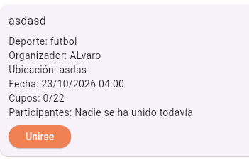
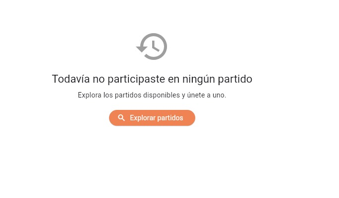
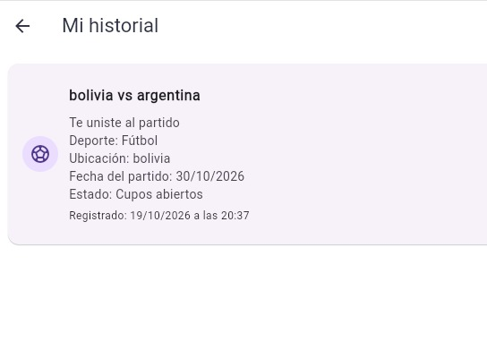

# Decisiones de interacción — Historial de UniSport

## Funcionalidad

El historial responde a la pregunta:

> ¿En qué partidos participó el usuario?

Cuando el usuario se une a un partido, UniSport registra el evento en la base
de datos. El usuario autenticado puede consultar sus eventos desde la pantalla
“Mi historial”.

---

## 1. Ley de Fitts

### Problema anterior

La acción “Unirse” se mostraba como un botón pequeño dentro de la información
del partido. Además, no existía una entrada directa para consultar el historial
de participaciones del usuario.

### Evidencia anterior

### Cambio realizado

Se agregó el botón “Mi historial” en la pantalla principal, junto con las
funciones principales de UniSport. El botón utiliza el mismo tamaño que
“Mis partidos” y “Explorar partidos”, por lo que ofrece un área amplia y fácil
de seleccionar.

Cuando el historial está vacío, se muestra un botón visible llamado
“Explorar partidos” cerca de la explicación de lo que el usuario debe hacer.

### Resultado

La entrada al historial y la acción recomendada del estado vacío son fáciles
de alcanzar. El usuario puede continuar mediante un botón visible y no necesita
seleccionar iconos pequeños.

### Evidencia posterior

### Referencias al código

- `frontend_flutter/lib/views/home_view/home_view.dart`
- `frontend_flutter/lib/views/partido_view/historial_partidos_view.dart`
- Métodos: `construirEstadoVacio()` y `abrirExplorarPartidos()`.

---

## 2. Ley de Hick

### Problema anterior

Antes de implementar el historial, el usuario debía buscar entre las pantallas
y tarjetas de partidos para recordar en cuáles había participado. No existía
una opción que reuniera sus participaciones en un solo recorrido.

La información del partido se mostraba directamente en la tarjeta, pero no
permitía distinguir fácilmente cuáles eran eventos anteriores del usuario.

### Evidencia anterior

### Cambio realizado

Se creó una pantalla de historial que presenta una sola lista cronológica.
No se muestran simultáneamente filtros o acciones que no sean necesarias para
comprender las participaciones.

Cada tarjeta representa un evento y mantiene juntas la acción realizada, el
partido relacionado y su estado.

### Resultado

El usuario puede revisar sus participaciones desde una sola opción, sin escoger
entre distintas pantallas o recorridos.

Los eventos aparecen ordenados del más reciente al más antiguo, lo que permite
encontrar primero la participación más reciente.

### Evidencia posterior

### Referencias al código

- `backend/app/modules/partidos/service.py`
- Función: `listar_historial()`.
- `frontend_flutter/lib/views/partido_view/historial_partidos_view.dart`
- Método: `construirLista()`.

---

## 3. Carga cognitiva

### Problema anterior

La pantalla anterior mostraba los datos del partido como un bloque de
información. Para recordar una participación, el usuario debía interpretar esos
datos y recordar si anteriormente se había unido al partido.

Tampoco se mostraba la fecha y hora de la participación como un evento
independiente.

### Evidencia anterior

### Cambio realizado

Cada registro del historial muestra primero el nombre del partido y la acción
realizada. Después presenta el deporte, la ubicación, la fecha del partido y
su estado.

La fecha y hora en que se registró la participación aparecen como información
secundaria. El estado vacío explica qué ocurrió y ofrece directamente la
siguiente acción que puede realizar el usuario.

### Resultado

El usuario puede comprender qué ocurrió sin recordar información de otras
pantallas. Cada evento contiene solamente los datos necesarios para identificar
la participación.

Los textos acompañan a los estados y no dependen solamente de colores o iconos.

### Evidencia posterior

### Referencias al código

- `frontend_flutter/lib/models/historial_partido.dart`
- Propiedades: `accionTexto`, `deporteTexto` y `estadoTexto`.
- `frontend_flutter/lib/views/partido_view/historial_partidos_view.dart`
- Métodos: `construirLista()`, `construirEstadoVacio()` y
  `fechaYHoraTexto()`.

---

## Verificación

- El usuario autenticado solamente puede consultar su propio historial.
- Unirse a un partido genera un evento persistente.
- El registro queda relacionado con el usuario y con el partido.
- El historial permanece disponible después de recargar la aplicación.
- Los eventos aparecen ordenados del más reciente al más antiguo.
- La pantalla muestra un estado vacío cuando no existen registros.
- La interfaz maneja los estados de carga y error.
- La funcionalidad utiliza datos reales obtenidos desde el backend.
- Las pruebas del backend y Flutter se ejecutan correctamente.
- Las decisiones de Fitts, Hick y carga cognitiva tienen evidencia anterior,
  explicación del cambio y evidencia posterior.