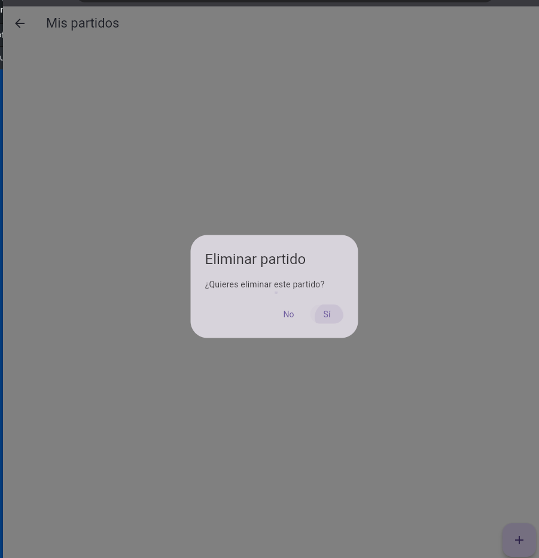
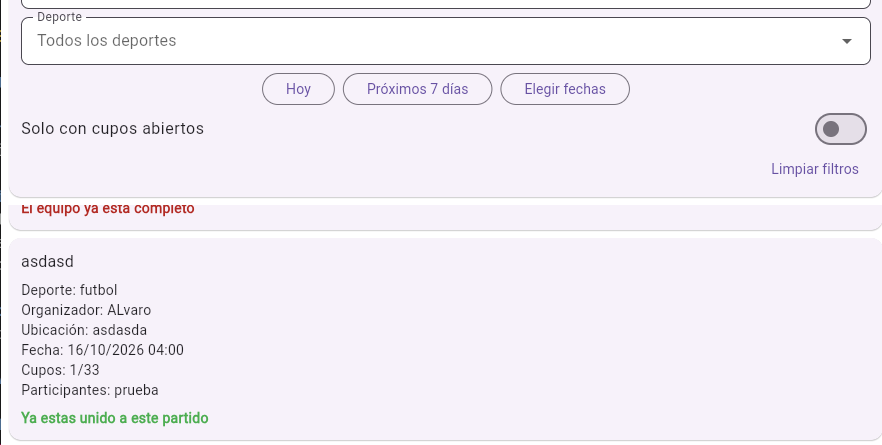
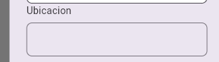
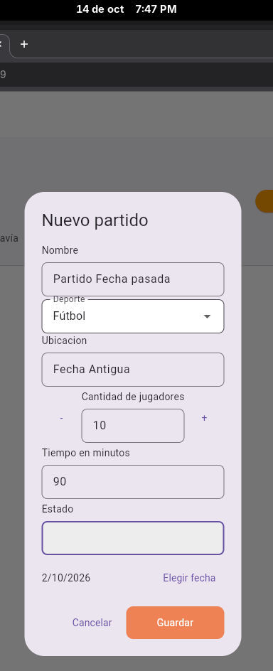
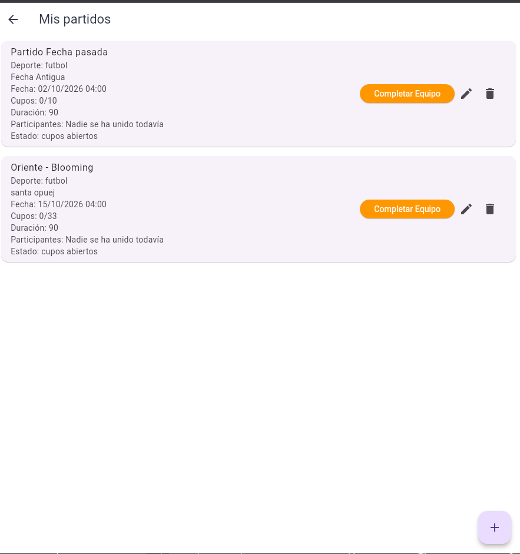
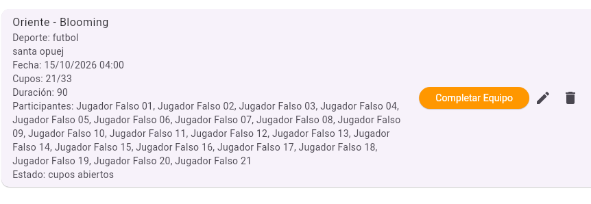
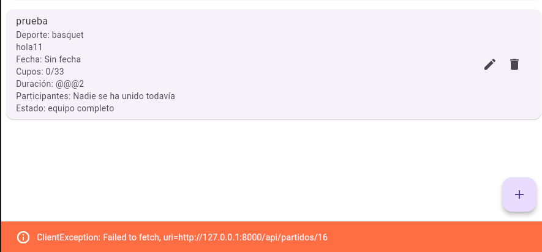
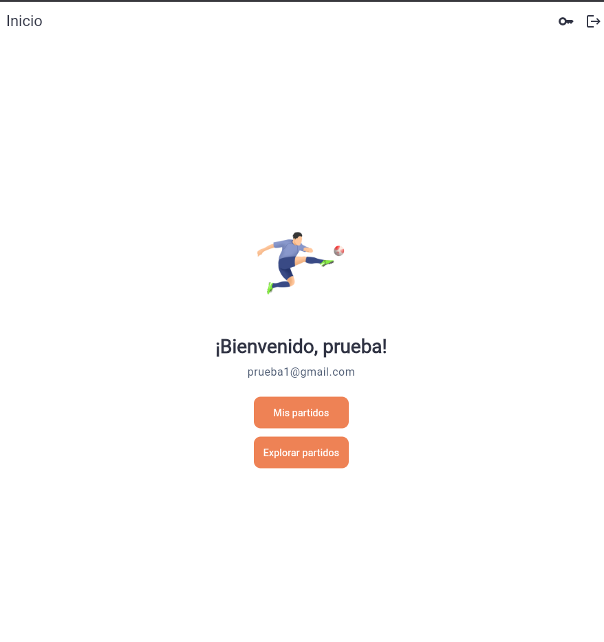

# Evaluación heurística H1-H10

## H1. Visibilidad del estado del sistema

**Estado:** No cumple.

**Pantallas y flujo revisado:** cargar partidos, unirse a un partido, crear, editar, eliminar y completar un equipo.

**Evidencia:** Las listas muestran un `CircularProgressIndicator` mientras cargan y se muestran mensajes como “Partido guardado”, “Partido eliminado” o “Te uniste al partido”. Sin embargo, las acciones de unirse, eliminar y completar no muestran un estado de procesamiento ni deshabilitan el control mientras esperan la respuesta del servidor.

**Captura:** 

**Problema y consecuencia:** Si la respuesta tarda, el usuario no sabe si la acción fue registrada y puede pulsar nuevamente el control.

**Severidad:** 2 — menor.

**Referencia:** `frontend_flutter/lib/views/partido_view/explorar_partidos_view.dart:152` y `frontend_flutter/lib/views/partido_view/list_partidoview.dart:87`.

## H2. Relación entre el sistema y el mundo real

**Estado:** No cumple.

**Pantallas y flujo revisado:** formulario y tarjetas de partidos.

**Evidencia:** La aplicación utiliza conceptos familiares como “Partido”, “Deporte”, “Ubicación”, “Cupos”, “Organizador” y “Unirse”. No obstante, el formulario muestra la etiqueta “Ubicacion” sin tilde, mientras que otras pantallas usan “Ubicación”. También hay mensajes sin tildes como “Ya estas” y “La fecha ya paso”.

**Captura:** 

**Problema y consecuencia:** El vocabulario se entiende, pero los errores ortográficos reducen la correspondencia con la escritura natural y la calidad percibida de la interfaz.

**Severidad:** 2 — menor.

**Referencia:** `frontend_flutter/lib/views/partido_view/formulario_partido.dart:138` y `frontend_flutter/lib/views/partido_view/explorar_partidos_view.dart:129`.

## H3. Control y libertad del usuario

**Estado:** No cumple.

**Pantallas y flujo revisado:** inscripción en un partido y gestión de partidos propios.

**Evidencia:** Después de unirse, el usuario solo recibe el mensaje “Ya estas unido a este partido”; no existe una acción para abandonar. El organizador puede marcar el partido como “equipo completo”, pero no puede reabrir los cupos. La eliminación solicita confirmación, pero no ofrece una opción para deshacerla.

**Captura:** 

**Problema y consecuencia:** El usuario no puede corregir decisiones importantes ni recuperar el control sobre un partido después de ejecutar determinadas acciones.

**Severidad:** 3–4 — mayor a crítica según la frecuencia del caso.

**Referencia:** `frontend_flutter/lib/views/partido_view/explorar_partidos_view.dart:152`, `frontend_flutter/lib/views/partido_view/list_partidoview.dart:117` y `backend/app/modules/partidos/service.py:182`.

## H4. Consistencia y estándares

**Estado:** No cumple.

**Pantallas y flujo revisado:** formulario, listado propio y exploración pública.

**Evidencia:** Hay diferencias de escritura y formato entre pantallas: “Ubicacion” frente a “Ubicación”, mensajes sin tildes y una presentación distinta de la información. En “Mis partidos” los datos aparecen concatenados en el subtítulo de un `ListTile`, mientras que en “Explorar partidos” se muestran como líneas independientes con etiquetas.

**Captura:** 

**Problema y consecuencia:** La interfaz sigue siendo comprensible, pero la falta de uniformidad hace que los elementos equivalentes parezcan menos relacionados.

**Severidad:** 2 — menor.

**Referencia:** `frontend_flutter/lib/views/partido_view/formulario_partido.dart:138`, `frontend_flutter/lib/views/partido_view/list_partidoview.dart:164` y `frontend_flutter/lib/views/partido_view/explorar_partidos_view.dart:350`.

## H5. Prevención de errores

**Estado:** No cumple.

**Pantallas y flujo revisado:** creación y edición de partidos, selección de fecha y acciones de gestión.

**Evidencia:** El formulario valida campos obligatorios y la cantidad de jugadores, y la eliminación incluye una confirmación. Sin embargo, el selector permite elegir fechas pasadas. Además, “Completar Equipo” se ejecuta sin confirmación y el cambio de estado no puede revertirse desde la interfaz.

**Captura:** 

**Problema y consecuencia:** El usuario puede guardar datos que después impedirán unirse al partido o cambiar permanentemente el estado por accidente.

**Severidad:** 3 — mayor.

**Referencia:** `frontend_flutter/lib/views/partido_view/formulario_partido.dart:51`, `frontend_flutter/lib/views/partido_view/list_partidoview.dart:117` y `backend/app/modules/partidos/service.py:216`.

## H6. Reconocer antes que recordar

**Estado:** Cumple.

**Pantallas y flujo revisado:** tarjetas de “Explorar partidos” y filtros activos.

**Evidencia:** Cada tarjeta muestra nombre, deporte, organizador, ubicación, fecha, cupos, participantes y el motivo por el que la acción no está disponible. Los filtros activos permanecen visibles como chips y pueden eliminarse individualmente.

**Captura:** 

**Resultado:** El usuario puede decidir si unirse sin recordar datos de otra pantalla.

**Referencia:** `frontend_flutter/lib/views/partido_view/explorar_partidos_view.dart:162` y `frontend_flutter/lib/views/partido_view/explorar_partidos_view.dart:343`.

## H7. Flexibilidad y eficiencia de uso

**Estado:** No cumple.

**Pantallas y flujo revisado:** panel de filtros y administración de partidos.

**Evidencia:** Explorar permite buscar por nombre o zona, filtrar por deporte, elegir “Hoy”, “Próximos 7 días”, un rango de fechas y mostrar solo partidos con cupos. También permite limpiar los filtros. Sin embargo, la administración requiere acciones individuales y no existen acciones rápidas, masivas ni filtros guardados para usuarios frecuentes.

**Captura:** 

**Problema y consecuencia:** Las búsquedas habituales se agilizan, pero las tareas repetitivas de gestión no tienen una alternativa eficiente.

**Severidad:** 1–2 — cosmética a menor.

**Referencia:** `frontend_flutter/lib/views/partido_view/explorar_partidos_view.dart:219` y `frontend_flutter/lib/views/partido_view/list_partidoview.dart:175`.

## H8. Diseño estético y minimalista

**Estado:** No cumple.

**Pantallas y flujo revisado:** tarjetas de exploración y listado de partidos propios.

**Evidencia:** Las tarjetas presentan información útil para seleccionar un partido, pero concatenan todos los nombres de participantes. En “Mis partidos” varios datos se muestran juntos dentro del subtítulo de un `ListTile`.

**Captura:** 

**Problema y consecuencia:** En grupos grandes las tarjetas pueden ocupar demasiado espacio, generar ruido visual y desplazar la acción principal.

**Severidad:** 2 — menor.

**Referencia:** `frontend_flutter/lib/views/partido_view/explorar_partidos_view.dart:145` y `frontend_flutter/lib/views/partido_view/list_partidoview.dart:164`.

## H9. Ayudar a reconocer, diagnosticar y recuperarse de los errores

**Estado:** No cumple.

**Pantallas y flujo revisado:** operaciones de carga, creación, edición, eliminación, completado e inscripción.

**Evidencia:** Los errores se muestran mediante un `SnackBar`. La inscripción y la exploración pueden mostrar mensajes específicos provenientes del backend, como “Ya estas unido a este partido” o “No quedan cupos disponibles”. En cambio, varias operaciones usan mensajes genéricos como “No se pudo crear el partido” o “No se pudo eliminar el partido”. El `SnackBar` no ofrece “Reintentar” ni otra acción de recuperación.

**Captura:** 

**Problema y consecuencia:** El usuario no siempre conoce la causa del error ni el siguiente paso que debe realizar.

**Severidad:** 3 — mayor.

**Referencia:** `frontend_flutter/lib/services/partido.dart:99` y `frontend_flutter/lib/widgets/mensaje.dart:3`.

## H10. Ayuda y documentación

**Estado:** No cumple.

**Pantallas y flujo revisado:** inicio, exploración, listado propio y formulario de partidos.

**Evidencia:** No hay una sección de ayuda, instrucciones contextuales, preguntas frecuentes ni documentación dentro de las pantallas revisadas. Existen etiquetas y validaciones puntuales, pero no una guía que explique cómo crear, completar, editar o administrar un partido.

**Captura:** 

**Problema y consecuencia:** Una persona nueva debe deducir el funcionamiento de la aplicación sin asistencia contextual.

**Severidad:** 2 — menor.

**Referencia:** vistas de `frontend_flutter/lib/views/partido_view/`.

