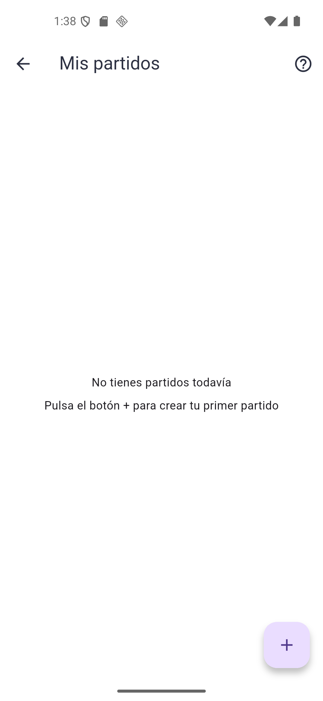
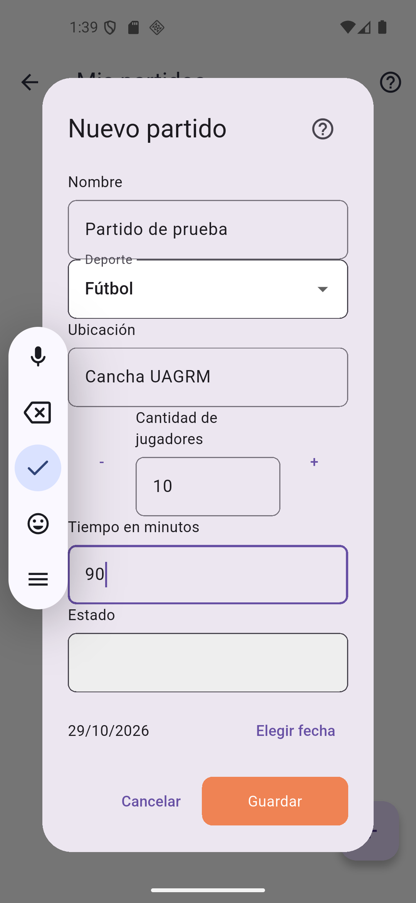
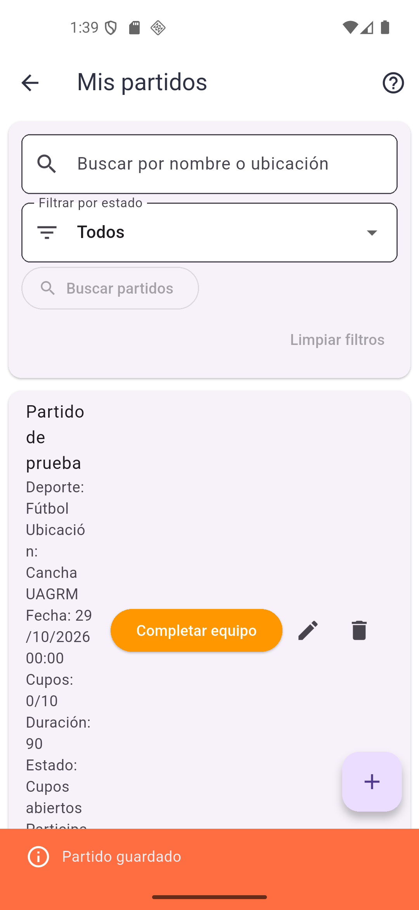
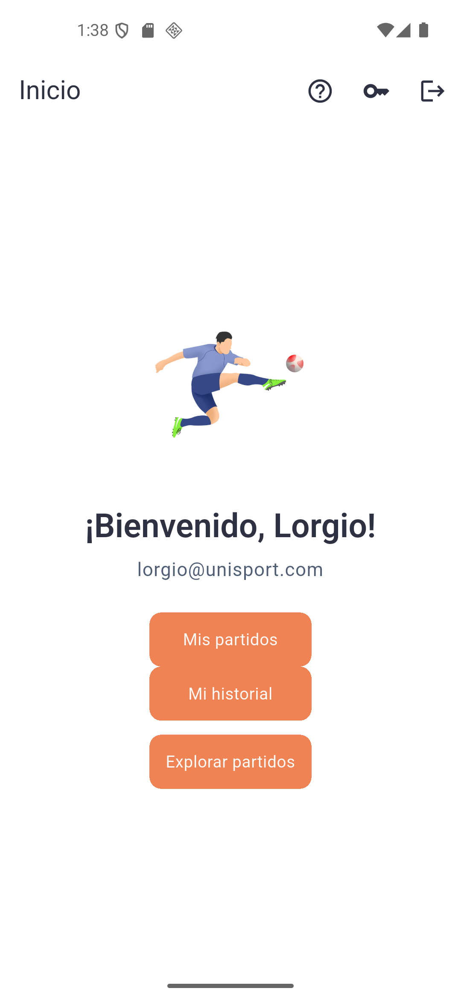

# Clase 17 · Análisis del proyecto recibido

## 1. Proyecto recibido

- **Proyecto:** UniSport, aplicación para organizar partidos y completar equipos.
- **Grupo anterior:** Alvaro Sonco Guzman y Juan Carlos Laura Cespedes.
- **Repositorio original:** https://github.com/alvaroSG34/proyecto2_ihc
- **Fork de trabajo:** https://github.com/Lorgio09/proyecto2_ihc
- **Estructura:** API en FastAPI con PostgreSQL (`backend/`) y aplicación en Flutter (`frontend_flutter/`).

## 2. Recorrido: crear un partido

| Paso | Qué ocurre | Archivo real |
|---|---|---|
| **Pantalla** | En **Mis partidos** el usuario pulsa el botón **+** y se abre el diálogo **Nuevo partido**. | [list_partidoview.dart:540](../../frontend_flutter/lib/views/partido_view/list_partidoview.dart#L540), [formulario_partido.dart](../../frontend_flutter/lib/views/partido_view/formulario_partido.dart) |
| **Acción** | Completa nombre, deporte, ubicación, cantidad de jugadores, tiempo y fecha, y pulsa **Guardar**. `guardar()` devuelve los datos a `abrirFormulario()`, que llama a `PartidoService.crear()`. Este envía `POST /api/partidos` con el token de sesión. | [formulario_partido.dart:104](../../frontend_flutter/lib/views/partido_view/formulario_partido.dart#L104), [list_partidoview.dart:175](../../frontend_flutter/lib/views/partido_view/list_partidoview.dart#L175), [partido.dart:101](../../frontend_flutter/lib/services/partido.dart#L101) |
| **Regla (app)** | Antes de enviar valida que los textos no estén vacíos, que la cantidad esté entre 1 y 100 y que la fecha exista y sea futura. | [formulario_partido.dart:91-115](../../frontend_flutter/lib/views/partido_view/formulario_partido.dart#L91-L115) |
| **Regla (API)** | La ruta exige un usuario autenticado. `DatosPartido` valida longitudes y cantidad (1 a 100). `crear_partido()` rechaza fechas pasadas con `422 FECHA_NO_FUTURA` y asigna al usuario como organizador. | [router.py:45](../../backend/app/modules/partidos/router.py#L45), [schemas.py:14](../../backend/app/modules/partidos/schemas.py#L14), [service.py:18](../../backend/app/modules/partidos/service.py#L18), [service.py:61](../../backend/app/modules/partidos/service.py#L61) |
| **Datos** | Se inserta una fila en la tabla `partidos` con `usuario_id` del organizador y estado inicial `cupos abiertos`. | [models.py:34](../../backend/app/database/models.py#L34), [7f3a1c2d9e4b_crea_tabla_partidos.py](../../backend/migrations/versions/7f3a1c2d9e4b_crea_tabla_partidos.py) |

### Evidencia del recorrido

| Mis partidos (vacío) | Formulario completo | Partido creado |
|---|---|---|
|  |  |  |

Registro guardado en PostgreSQL:

```
 id | usuario_id |      nombre       | deporte |  ubicacion   | cantidad_jugadores | tiempo_min |     estado
----+------------+-------------------+---------+--------------+--------------------+------------+----------------
  1 |          1 | Partido de prueba | futbol  | Cancha UAGRM |                 10 | 90         | cupos abiertos
```

## 3. Ejecución

Backend, desde `backend/`:

```powershell
python -m venv .venv
.\.venv\Scripts\python.exe -m pip install -r requirements.txt
# .env creado a partir de .env.example (DATABASE_URL y SECRET_KEY)
psql -U postgres -c "CREATE DATABASE unisport;"
.\.venv\Scripts\alembic.exe upgrade head
.\.venv\Scripts\uvicorn.exe app.main:app --reload
```

Aplicación, desde `frontend_flutter/`:

```powershell
flutter pub get
flutter run -d emulator-5554
```

Pruebas del backend: `python -m pytest -q tests/test_partidos_uniones.py` → **15 passed**.



**Problemas encontrados al ejecutar:**

- `flutter run` falla en la raíz del repositorio; hay que correrlo dentro de `frontend_flutter/`.
- El README del backend no indica que hay que crear la base de datos antes de ejecutar `alembic upgrade head`.
- No existe un usuario de prueba; hay que registrarse antes de entrar.

## 4. Impacto: Tarea 5

**Enunciado para UniSport:** unirse a un partido y mostrar la lista actualizada de jugadores. El resultado debe mantenerse después de recargar o volver a entrar.

### Lo que ya existe

El grupo anterior ya implementó la relación usuario ↔ partido:

- **Datos:** tabla `partido_participantes` con clave primaria compuesta (`partido_id`, `usuario_id`), que impide inscribirse dos veces. Ver [models.py:78](../../backend/app/database/models.py#L78) y [8c9d0e1f2a3b_crea_participantes.py](../../backend/migrations/versions/8c9d0e1f2a3b_crea_participantes.py).
- **API:** `POST /api/partidos/{id}/unirse` y `DELETE /api/partidos/{id}/salir` ([router.py:198](../../backend/app/modules/partidos/router.py#L198), [router.py:216](../../backend/app/modules/partidos/router.py#L216)).
- **Reglas** en `unirse_partido()` ([service.py:264](../../backend/app/modules/partidos/service.py#L264)):
  - el organizador no puede unirse a su propio partido;
  - solo se puede unir a partidos con cupos abiertos y fecha futura;
  - se rechaza la inscripción duplicada (`409 YA_INSCRITO`) y la que no tiene cupos;
  - al llenarse los cupos el partido pasa a `equipo completo`;
  - cada inscripción queda registrada en el historial.
- **App:** en **Explorar partidos**, **Unirse** y **Salir** recargan la lista después de la acción, y **Ver participantes** muestra los nombres ([explorar_partidos_view.dart:159](../../frontend_flutter/lib/views/partido_view/explorar_partidos_view.dart#L159)).

**Verificación:** un segundo usuario se unió al partido de prueba por la API. La respuesta devolvió la lista con su nombre y `cupos_disponibles: 9`. El organizador vio el mismo participante al consultar el partido, y un segundo intento devolvió `409`. Como la inscripción queda en PostgreSQL, se mantiene al recargar o volver a entrar.

### Lo que deberá cambiar

| Cambio | Motivo | Archivos |
|---|---|---|
| Reorganizar la tarjeta de **Mis partidos** para que las acciones queden debajo del contenido. | Las tres acciones (`Completar equipo`, editar, eliminar) van en el `trailing` del `ListTile` y dejan el texto en una columna muy angosta (ver captura *Partido creado*). Con la lista de jugadores el texto queda casi ilegible. | [list_partidoview.dart:459](../../frontend_flutter/lib/views/partido_view/list_partidoview.dart#L459) |
| Actualizar la lista del organizador sin salir de la pantalla. | **Mis partidos** solo recarga al entrar o al deslizar hacia abajo. Si alguien se une mientras el organizador tiene la pantalla abierta, no lo ve. | [list_partidoview.dart:393](../../frontend_flutter/lib/views/partido_view/list_partidoview.dart#L393) |
| Bloquear la fila del partido al unirse (`with_for_update()`). | `unirse_partido()` cuenta los participantes y luego inserta sin bloqueo. Dos usuarios que se unan al mismo tiempo al último cupo podrían superar `cantidad_jugadores`. | [service.py:312](../../backend/app/modules/partidos/service.py#L312) |
| Agregar una prueba de widget para **Unirse** → lista actualizada. | Las pruebas de Flutter cubren el formulario y las heurísticas H5, H7 y H9, pero no el flujo de unirse. | `frontend_flutter/test/` |
