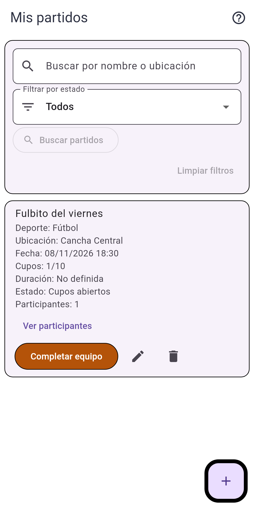
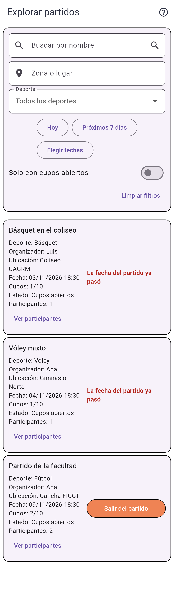
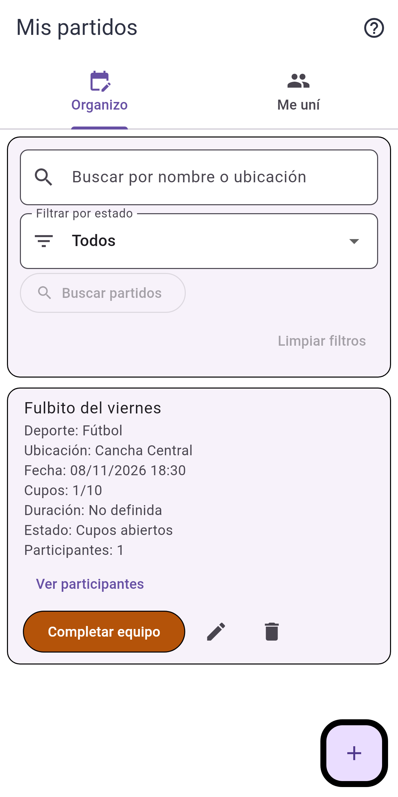
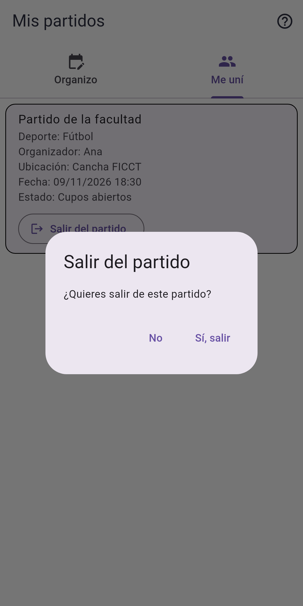

# Clase 20 · Arquitectura de información

## Integrantes

- Diego Andrés Astete Paz
- Lorgio Choque Severiche

**Proyecto:** UniSport, una aplicación para organizar partidos y completar equipos (Flutter + FastAPI).

## 1. Problema

**Tarea difícil de encontrar:** *"Me uní a un partido y ya no puedo ir. ¿Dónde salgo de ese partido?"*

En la versión anterior, la app tenía tres secciones en el inicio:

| Sección | Qué mostraba |
|---|---|
| **Mis partidos** | Solo los partidos que **creé** como organizador. |
| **Mi historial** | Un registro de eventos ("Te uniste", "Saliste"), sin ninguna acción. |
| **Explorar partidos** | Todos los partidos de otros usuarios, con filtros. |

Los partidos a los que me uní no tenían un lugar propio. La única forma de salir de uno era entrar a **Explorar partidos** y buscarlo entre los partidos de todos. El nombre "Mis partidos" hacía pensar que ahí estaban, pero no aparecían. Es un problema de **agrupación** (la función está en una sección que no le corresponde) y de **nombres** (la etiqueta "Mis partidos" promete más de lo que muestra).

## 2. Propuesta

```text
ANTES                                   DESPUÉS
Inicio                                  Inicio
├── Mis partidos                        ├── Mis partidos
│   └── (solo los que creé)             │   ├── [Organizo]  partidos que creé
├── Mi historial                        │   │     + crear, editar, eliminar,
│   └── (registro, sin acciones)        │   │       completar equipo
└── Explorar partidos                   │   └── [Me uní]    partidos a los que me uní
    ├── partido ajeno                   │         + Salir del partido
    ├── partido ajeno                   ├── Mi historial  (sin cambios)
    └── partido al que me uní           └── Explorar partidos (sin cambios,
          + Salir del partido  ← aquí         sigue permitiendo unirse y salir)
```

- **Secciones:** "Mis partidos" se divide en dos pestañas, **Organizo** y **Me uní**.
- **Etiquetas:** "Organizo" y "Me uní" describen la relación del usuario con el partido. Cada pestaña tiene un ícono: calendario con lápiz para organizar y grupo de personas para unirse.
- **Acceso a la función:** el botón **Salir del partido** queda en cada tarjeta de "Me uní", con la misma confirmación que en Explorar. El botón **+ Nuevo partido** solo aparece en "Organizo", porque crear un partido no tiene sentido en "Me uní".

## 3. Motivo

- El usuario piensa en "mis partidos" como todos los partidos en los que participa, no solo los que organiza. La nueva estructura sigue ese modelo mental.
- Explorar sirve para **buscar partidos nuevos**, no para administrar los que ya tengo. Mezclar las dos tareas obligaba a filtrar mentalmente una lista larga.
- Se eligieron pestañas y no una cuarta opción en el inicio, para no agregar otro botón y mantener juntas las dos caras de "mis partidos".
- Es un cambio pequeño: no se tocó el backend. La pestaña "Me uní" filtra los partidos de Explorar donde el usuario es participante o suplente.

## 4. Capturas antes y después

### Antes

| Mis partidos (solo los que creé) | Para salir había que ir a Explorar |
|---|---|
|  |  |

### Después

| Pestaña Organizo | Pestaña Me uní | Confirmación al salir |
|---|---|---|
|  |  |  |

## 5. Resultado de la prueba

Las pruebas automáticas están en `frontend_flutter/test/mis_partidos_pestanas_test.dart`:

| Prueba | Qué verifica | Resultado |
|---|---|---|
| Mis partidos separa Organizo y Me uní | Aparecen las dos pestañas. "Organizo" muestra el partido propio. "Me uní" muestra solo el partido donde el usuario participa (no el ajeno) y oculta el botón "+". | ✅ Pasa |
| Desde Me uní se puede salir del partido | Al pulsar "Salir del partido" y confirmar, se llama al servicio, el partido desaparece, aparece "Saliste del partido" y se ve el estado vacío. | ✅ Pasa |
| Sin usuario se mantiene la vista anterior | La vista sigue funcionando como antes cuando no recibe un usuario, así no se rompen las pruebas existentes. | ✅ Pasa |

Suite completa de widget tests: **40/40 pruebas pasan** (`flutter test`).

## 6. Commit

- Implementación: [`e5bc367` feat: separar Mis partidos en pestañas Organizo y Me uní](https://github.com/Lorgio09/proyecto2_ihc/commit/e5bc367d882cbcf362c7b111d1904dd5da1ca8c9)
