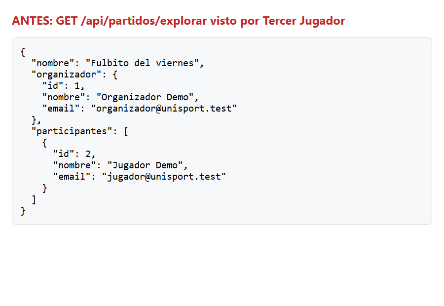
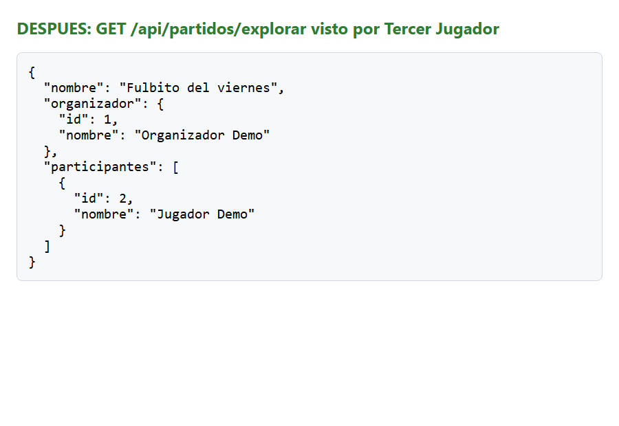

# Clase 22 · Patrones oscuros

**Integrantes:** Diego Andrés Astete Paz, Lorgio Choque Severiche
**Modalidad:** con IA

## 1. Patrón encontrado

**Tipo (de los seis):** 4 · Datos expuestos sin necesidad.

**Dónde:** pantalla **Explorar partidos** (y también Mis partidos, Me uní y Resultado del partido). El origen es la respuesta de la API para "una persona dentro de un partido": `backend/app/modules/partidos/schemas.py:6`, clase `RespuestaUsuarioPartido`, que incluía el campo `email`. Lo leía la app en `frontend_flutter/lib/models/partido.dart:3`, clase `UsuarioPartido`.

**Por qué es un patrón oscuro:** cualquier persona con sesión iniciada que abría Explorar recibía el **email del organizador y de todos los jugadores** de cada partido. La app no lo mostraba en ninguna pantalla, pero viajaba en cada respuesta y se podía leer con las herramientas del navegador o llamando a la API directamente.

- **A quién beneficia:** a nadie del lado del usuario. Al sistema le resultaba cómodo devolver al usuario completo en vez de elegir qué campos enviar.
- **Qué no ve el usuario:** que su email queda expuesto a desconocidos solo por organizar un partido o unirse a uno. No hay ningún aviso ni forma de evitarlo.

## 2. Antes

Respuesta real de `GET /api/partidos/explorar` vista por **Tercer Jugador**, que no participa del partido ([`clase-22/antes-explorar.json`](clase-22/antes-explorar.json)):



```json
{
  "nombre": "Fulbito del viernes",
  "organizador": { "id": 1, "nombre": "Organizador Demo", "email": "organizador@unisport.test" },
  "participantes": [
    { "id": 2, "nombre": "Jugador Demo", "email": "jugador@unisport.test" }
  ]
}
```

```python
# backend/app/modules/partidos/schemas.py
class RespuestaUsuarioPartido(BaseModel):
    model_config = ConfigDict(from_attributes=True)

    id: int
    nombre: str
    email: str
```

## 3. Después

La misma consulta, con el mismo usuario ([`clase-22/despues-explorar.json`](clase-22/despues-explorar.json)):



```json
{
  "nombre": "Fulbito del viernes",
  "organizador": { "id": 1, "nombre": "Organizador Demo" },
  "participantes": [
    { "id": 2, "nombre": "Jugador Demo" }
  ]
}
```

```python
# backend/app/modules/partidos/schemas.py
class RespuestaUsuarioPartido(BaseModel):
    """A person as seen inside a match: only what the screens show.

    The email is left out on purpose: seeing who organizes or plays only needs
    the name, and sending it would expose it to anyone exploring matches.
    """

    model_config = ConfigDict(from_attributes=True)

    id: int
    nombre: str
```

```dart
// frontend_flutter/lib/models/partido.dart
/// A person inside a match. Only the name: the screens never show the email,
/// so the API does not send it (data minimization).
class UsuarioPartido {
  final int id;
  final String nombre;
  ...
}
```

Como el mismo esquema se usa en todas las respuestas de partidos, el arreglo cubre a la vez Explorar, Mis partidos, Me uní, suplentes, bajas tardías y la validación del resultado (equipos y capitán). **Las pantallas no cambian**: siguen mostrando los mismos nombres. Lo que cambia es lo que viaja por detrás.

**Commit:** `fix: no exponer el email de organizador y jugadores en las respuestas de partidos`

## 4. Principio aplicado

**Minimización de datos (Clase 21)** y **privacidad por defecto.** Solo se envía lo que la tarea necesita: para ver un partido alcanza el nombre de quien organiza y de quien juega. Ninguna pantalla usa el email de otra persona, así que no se envía. El email propio sigue disponible donde corresponde: el login y la pantalla de inicio de cada uno, que usan otra respuesta (`/api/auth/yo`).

## 5. Prueba

`backend/tests/test_privacidad.py`:

| Prueba | Qué comprueba | Antes | Después |
|---|---|---|---|
| `test_explorar_no_expone_el_email_de_nadie` | Un desconocido ve en Explorar (lista y detalle) los nombres del organizador y del jugador, pero ninguna respuesta contiene un email | **Falla** (`assert '@' not in '...rreo.com"}}]'`) | **Pasa** |
| `test_ni_el_organizador_ni_los_jugadores_reciben_emails` | Tampoco viajan emails en Mis partidos (organizador) ni en Me uní (jugador) | **Falla** | **Pasa** |

Además, la app se adaptó: `UsuarioPartido` ya no espera un email, y se comprobó que lee sin errores la respuesta nueva del backend.

- Backend: **76 pruebas pasan** (74 anteriores y las 2 nuevas).
- Widgets de Flutter: **47 pasan**.

## 6. Otros que encontramos

**5 · Salir más difícil que entrar (prueba de simetría), en Explorar.** No se corrigió hoy.

| Comparen | Entrar · Unirse | Salir · darse de baja |
|---|---|---|
| Toques | 1 | 2: botón y diálogo de confirmación (`explorar_partidos_view.dart:207`) |
| Botón | Verde, 180×56, texto en negrita de 20 (`:553-557`) | Botón común, más chico (`:533`) |
| Texto | "Unirse" | "Salir del partido" y luego "Sí, salir" / "No" |
| Consecuencias | Explicadas | Explicadas: dentro de las 2 horas, la app avisa que quedará como baja tardía |

**Nuestra lectura:** el texto es neutral y explica la consecuencia real, sin culpa, y la confirmación se puede defender con prevención de errores (Nielsen #5), porque al salir el lugar pasa al primer suplente y no se recupera. Lo que sí falla la prueba de simetría es el **peso visual**: la opción del usuario (salir) se ve bastante menos clara que la que conviene al sistema (unirse). Una mejora sería que "Salir del partido" tenga el mismo tamaño que "Unirse", en un color neutro, y que el diálogo diga "Salir del partido" y "Volver" en vez de "Sí, salir" y "No".
