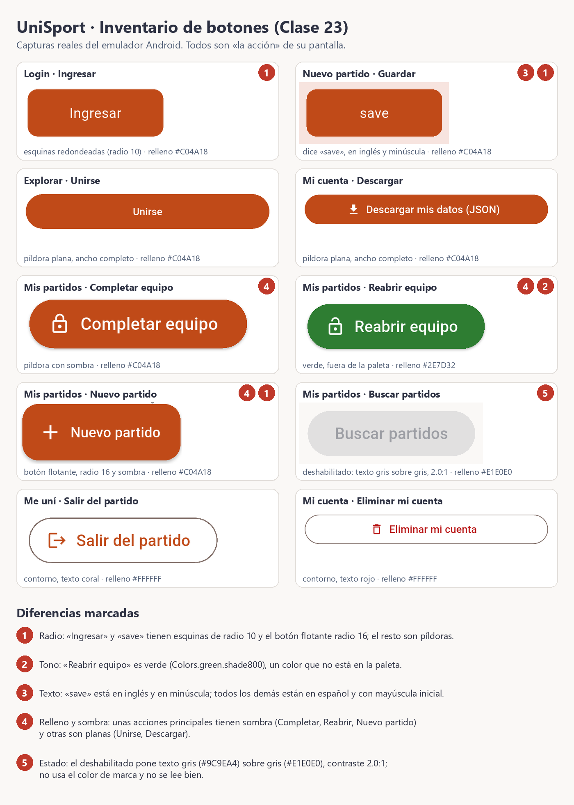

# Clase 23 · Inventario y tokens

**Integrantes:** Diego Andrés Astete Paz · Lorgio Choque Severiche · **Modalidad:** con IA

---

## 1. Inventario

Capturas reales de los botones de UniSport (emulador Android), uno al lado del otro:

**Diferencias encontradas:**

1. **Radio:** «Ingresar» y «save» tienen esquinas de radio 10 y el botón flotante «Nuevo partido» radio 16; el resto son píldoras.
2. **Tono:** «Reabrir equipo» es verde (`#2E7D32`), un color que no está en la paleta; las demás acciones son coral (`#C04A18`).
3. **Texto:** el botón para guardar un partido dice «save», en inglés y en minúscula; los demás están en español.
4. **Relleno y sombra:** unas acciones principales tienen sombra (Completar, Reabrir, Nuevo partido) y otras son planas (Unirse, Descargar).
5. **Estado:** el deshabilitado pone texto gris sobre gris (contraste 2.0:1) y casi no se lee.

---

## 2. Tokens

| Token | Claro | Oscuro | Dónde se usa |
|---|---|---|---|
| `color/primario` | `#C04A18` | `#F0956C` | Fondo de la acción principal (Ingresar, Unirse, Completar equipo, Nuevo partido), enlaces e íconos de marca |
| `color/texto` | `#2D3142` | `#ECEAE7` | Títulos y texto principal de todas las pantallas |
| `color/fondo` | `#FAF8F6` | `#1C1E26` | Fondo de todas las pantallas |
| `color/error` | `#B3261E` | `#F2B8B5` | Mensajes de error de los campos y la acción «Eliminar mi cuenta» |
| `radio/pildora` | `999` | `999` | Forma de todos los botones y de la insignia de estado |

---

## 3. Colores fijos

- **Pantalla revisada:** Mis partidos (`lib/views/partido_view/list_partidoview.dart` y su tarjeta `lib/widgets/tarjeta_partido.dart`).
- **Qué buscamos:** con Ctrl+Shift+F en VS Code, con expresión regular: `Color\(0x|Color\.fromRGBO|Color\.fromARGB|Colors\.|#[0-9a-fA-F]{6}`
- **Cuántos encontramos:** **8** (3 en `list_partidoview.dart` y 5 en `tarjeta_partido.dart`).
