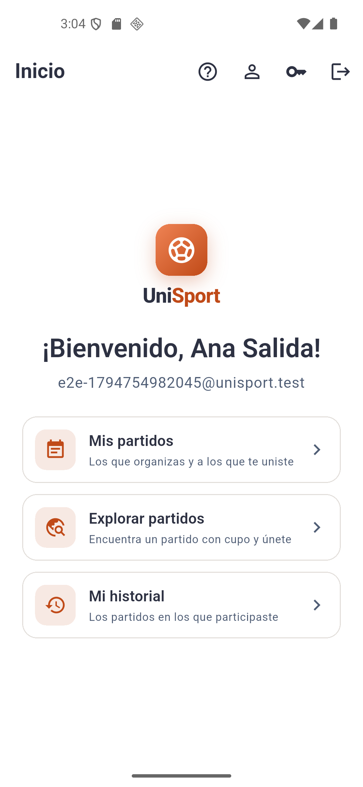
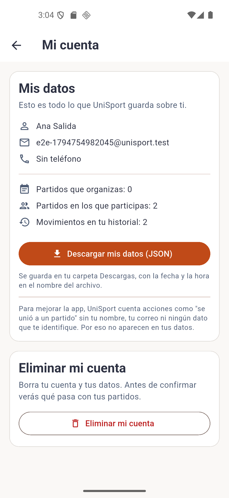
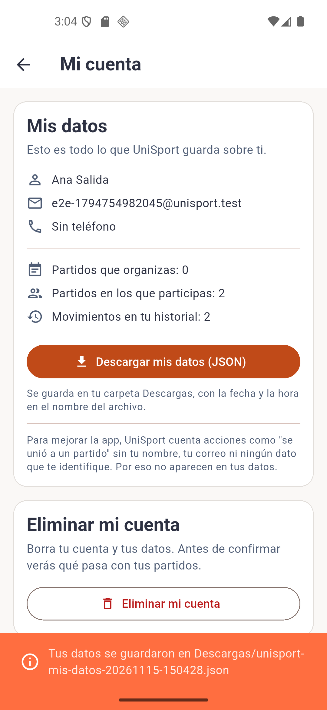
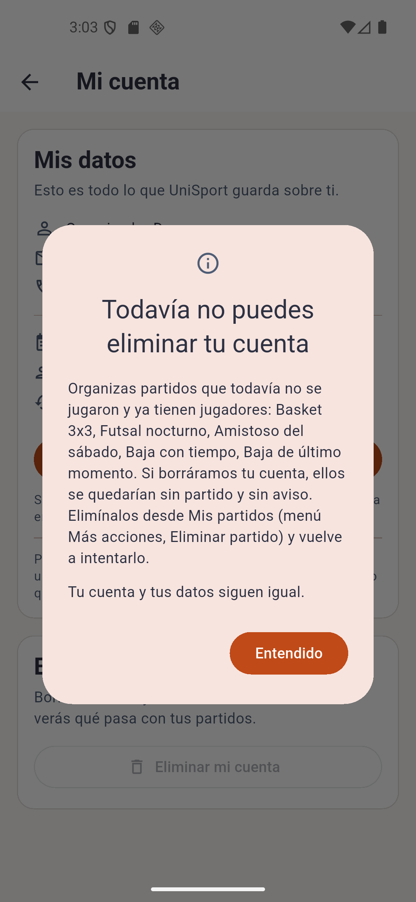
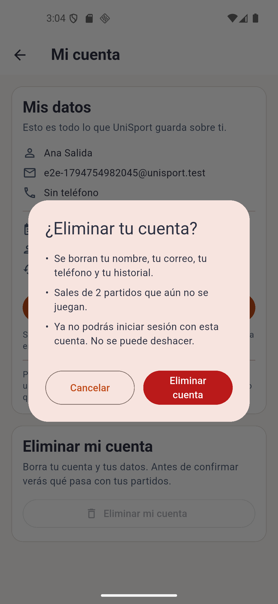
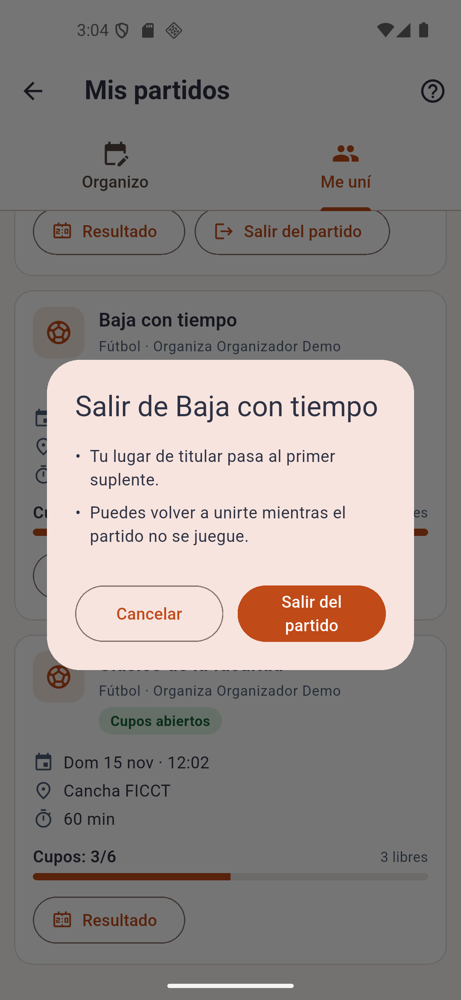
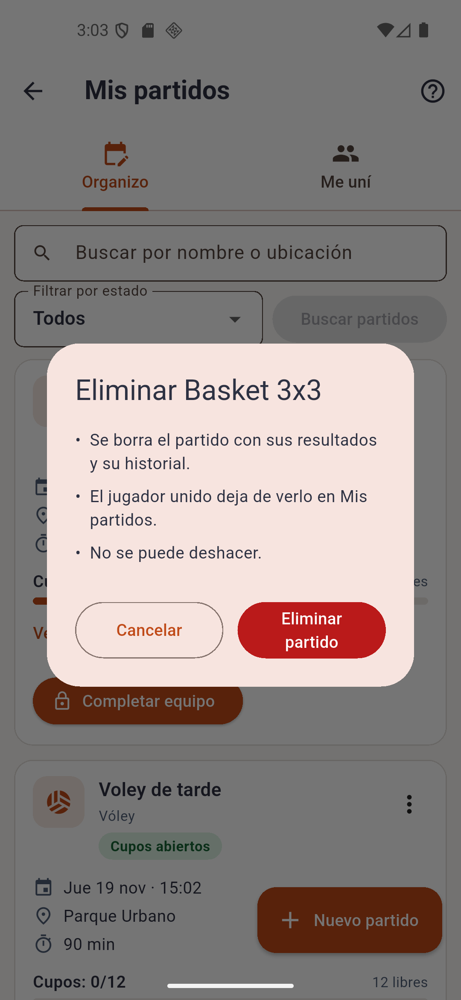
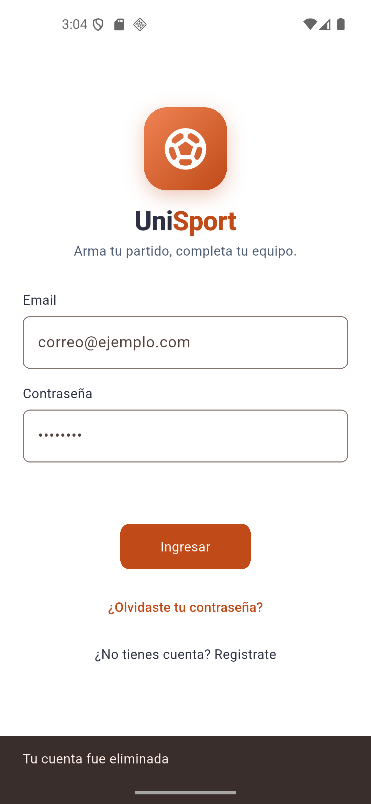
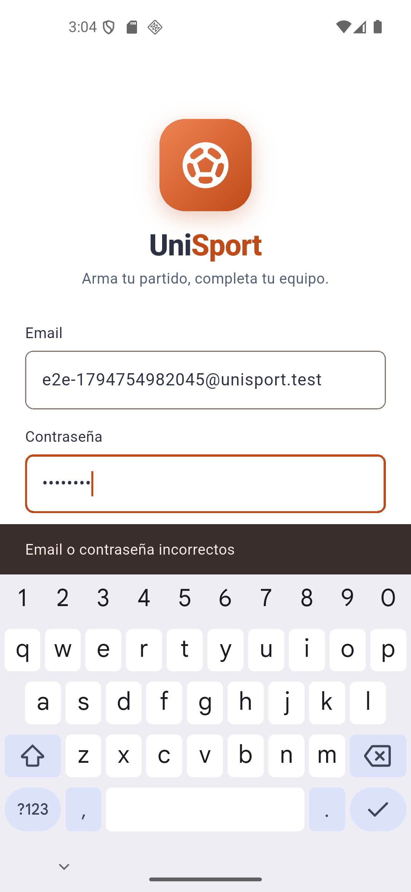

# Tarea 10 · Mis datos y salida honesta (UniSport)

## Integrantes

- Diego Andrés Astete Paz
- Lorgio Choque Severiche

**Proyecto:** UniSport, una aplicación para organizar partidos y completar equipos (Flutter + FastAPI + PostgreSQL).

| Parte | Commit |
|---|---|
| 1 · Mis datos: ver y descargar | [`98beca2`](https://github.com/Lorgio09/proyecto2_ihc/commit/98beca27d6ba626e41f22acc90c54f13d3fae59a) `feat: ver y descargar mis datos en JSON desde Mi cuenta` |
| 2 · Eliminar la cuenta con la regla de UniSport | [`7bf34d8`](https://github.com/Lorgio09/proyecto2_ihc/commit/7bf34d8165fa2f42eef18c93f6308c1dc74f423b) `feat: eliminar la cuenta con la regla de UniSport, bloqueos explicados y confirmación honesta` |
| 3 · Confirmaciones honestas y revisión de los seis patrones | [`55d647b`](https://github.com/Lorgio09/proyecto2_ihc/commit/55d647bd74e55c14ed0c5033037897c14c6c686e) `feat: confirmaciones honestas con consecuencias y botones del mismo tamaño en toda la app` |
| 4 · E2E del recorrido con eventos | [`68d9a9f`](https://github.com/Lorgio09/proyecto2_ihc/commit/68d9a9fdfa088efbe881116d858aea76b40895f5) `test: E2E de mis datos, eliminación bloqueada y completa con eventos; descarga con nombre único` |

---

## Parte 1 · Mis datos: ver y descargar

**Dónde:** Inicio → ícono de persona ("Mi cuenta") → tarjeta **Mis datos**.

- Muestra todo lo que UniSport guarda sobre la persona: nombre, correo, teléfono, los partidos que organiza, los partidos en los que participa y su historial.
- El botón **Descargar mis datos (JSON)** guarda el archivo en la carpeta Descargas del teléfono. El nombre lleva fecha y hora, por ejemplo `unisport-mis-datos-20261115-102030.json`, y el aviso dice exactamente dónde quedó.
- El JSON trae **solo los datos de la persona**. No incluye el hash de la contraseña, el token de recuperación ni los correos u otros datos de los demás jugadores. Lo comprueba `backend/tests/test_mis_datos.py::test_mis_datos_no_incluye_datos_ajenos_ni_secretos`.

| Pieza | Archivo |
|---|---|
| Endpoint `GET /api/cuenta/mis-datos` | `backend/app/modules/cuenta/router.py:19` |
| Arma los datos | `backend/app/modules/cuenta/service.py:17` (`mis_datos`) |
| Pantalla | `frontend_flutter/lib/views/cuenta/mi_cuenta_view.dart` |
| Guardar en Descargas (Android, sin pedir permisos) | `frontend_flutter/lib/services/cuenta_service.dart` (`guardarEnDescargas`) |

> **Bug encontrado por el E2E:** en Android, si en Descargas ya había un archivo con el mismo nombre creado por una instalación anterior de la app, el sistema no deja sobrescribirlo y la descarga fallaba. Lo resolvimos con un nombre nuevo en cada descarga (fecha y hora).

---

## Parte 2 · Eliminar la cuenta con la regla de UniSport

> **Regla:** "Si es titular en partidos futuros, sube el primer suplente. Los resultados confirmados se conservan, pero de forma anónima."

**Dónde:** Mi cuenta → tarjeta **Eliminar mi cuenta** → un botón → una confirmación. Salir cuesta lo mismo que entrar.

### Qué pasa al eliminar

| Dato de la persona | Qué hacemos |
|---|---|
| Lugar de titular en un partido futuro | Se libera y **sube el primer suplente** (por orden de llegada, con la misma función `promover_suplentes` de la Tarea 6). Si no hay suplente, el partido vuelve a "cupos abiertos". |
| Lugar de suplente en un partido futuro | Se borra. |
| Partido ya jugado **con resultado confirmado** (como jugador, capitán rival u organizador) | Se conserva el partido y su marcador. En lugar de la persona aparece **"Usuario eliminado"**, una cuenta anónima con contraseña aleatoria con la que nadie puede iniciar sesión. |
| Partido ya jugado sin resultado confirmado | No hay nada que conservar: se borra la participación, y el partido si lo organizaba. |
| Capitán rival de un partido que todavía no se juega | Se quita la capitanía y los equipos vuelven a "sin aceptar", para que el organizador elija otro capitán. |
| Partidos que organiza sin jugadores | Se borran. |
| Nombre, correo, teléfono, contraseña, token de recuperación e historial | Se borran. |

Después de eliminarla, **esa cuenta no puede iniciar sesión**: el login responde 401. La app cierra la sesión guardada en el teléfono y vuelve al login con el aviso "Tu cuenta fue eliminada".

### Cuándo la regla bloquea la eliminación (y qué le decimos)

Antes de mostrar la confirmación, la app consulta `GET /api/cuenta/eliminacion`, que devuelve los bloqueos y las consecuencias. Si hay un bloqueo, el diálogo **"Todavía no puedes eliminar tu cuenta"** dice por qué y qué hacer, y aclara que la cuenta y los datos siguen igual.

| Código | Por qué bloquea | Qué le decimos que haga |
|---|---|---|
| `ORGANIZA_PARTIDOS_CON_JUGADORES` | Organiza partidos que todavía no se juegan y ya tienen jugadores. Si se borrara la cuenta, ellos se quedarían sin partido y sin aviso. | Nombra esos partidos y le pide eliminarlos desde Mis partidos (menú Más acciones → Eliminar partido) y volver a intentarlo. |
| `CAPITAN_CON_RESULTADO_PENDIENTE` | Es capitán rival y hay un marcador esperando su validación (Tarea 8). Sin él nadie podría validarlo. | Le pide confirmarlo o disputarlo en Mis partidos → Me uní → Resultado y volver a intentarlo. |

El backend vuelve a revisar la regla en `DELETE /api/cuenta`. Si algo cambió entre la consulta y la confirmación, responde 409 con el mismo mensaje.

| Pieza | Archivo |
|---|---|
| Bloqueos | `backend/app/modules/cuenta/service.py:115` (`bloqueos_eliminacion`) |
| Consecuencias en números (para la confirmación) | `backend/app/modules/cuenta/service.py:160` (`consecuencias_eliminacion`) |
| Eliminación con la regla | `backend/app/modules/cuenta/service.py:203` (`eliminar_cuenta`) |
| Endpoints `GET /api/cuenta/eliminacion` y `DELETE /api/cuenta` | `backend/app/modules/cuenta/router.py:27` y `:41` |
| Pantalla y diálogos | `frontend_flutter/lib/views/cuenta/mi_cuenta_view.dart` |

### La confirmación honesta

```text
┌──────────────────────────────────────────────┐
│ ¿Eliminar tu cuenta?                         │
│ • Se borran tu nombre, tu correo, tu teléfono│
│   y tu historial.                            │
│ • Sales de 1 partido que aún no se juega.    │
│   Tu lugar de titular pasa al primer suplente│
│ • Los resultados confirmados de 1 partido se │
│   conservan, pero aparecerás como            │
│   "Usuario eliminado".                       │
│ • Ya no podrás iniciar sesión con esta       │
│   cuenta. No se puede deshacer.              │
│                                              │
│  [   Cancelar   ]   [ Eliminar cuenta ]      │
└──────────────────────────────────────────────┘
```

- **Mismo tamaño:** los dos botones ocupan el mismo ancho y alto, aunque una etiqueta se parta en dos líneas en un teléfono angosto. Un test lo mide.
- **Consecuencias explicadas:** con los números reales de esa cuenta, y solo las líneas que le aplican.
- **Sin culpa:** no hay "¿Seguro que quieres abandonarnos?" ni "Te vamos a extrañar". Solo hechos.
- **Sin pasos de más:** un botón y una confirmación. No pedimos escribir "ELIMINAR", ni la contraseña, ni una encuesta de por qué se va.

---

## Parte 3 · Revisión de los seis patrones en toda la app

Revisamos cada pantalla: login, registro, recuperar contraseña, Inicio, Mis partidos (Organizo / Me uní), Explorar, Resultado del partido, Historial y Mi cuenta. También revisamos los diálogos y las respuestas del backend.

Para corregir las confirmaciones creamos un diálogo compartido, `frontend_flutter/lib/widgets/confirmacion.dart` (`confirmarAccion`):
- dice qué va a pasar;
- el botón nombra la acción en lugar de "Sí / No";
- Cancelar y la acción tienen el mismo tamaño y peso;
- las acciones destructivas van en rojo.

Ahora lo usan todas las confirmaciones de la app.

| # | Patrón | Lo encontrado | Corregido | Pendiente |
|---|---|---|---|---|
| 1 | **Opciones preseleccionadas** | Revisamos los filtros de Explorar, las casillas de equipos en Resultado, el registro y el formulario de partido. No hay ninguna opción marcada por defecto: "Solo con cupos" empieza apagado y las casillas del equipo B empiezan vacías. | No hizo falta. | — |
| 2 | **Confirmaciones engañosas** | "Salir del partido", "Eliminar partido" y "Reabrir equipo" preguntaban "¿Quieres…?" con botones **No / Sí**. No decían qué pasaba ni qué hacía cada botón, y los botones eran de texto, de distinto ancho. | Todas usan `confirmarAccion`: <br>• **Salir:** dice si tu lugar pasa al suplente, si queda como baja tardía y que puedes volver a unirte. <br>• **Eliminar partido:** dice que se borran resultados e historial, cuántos jugadores dejan de verlo y que no se puede deshacer. <br>• **Completar / Reabrir:** dicen qué pasa con los cupos. <br>Los botones nombran la acción ("Salir del partido", "Eliminar partido") y tienen el mismo tamaño. Archivos: `confirmar_salida.dart`, `list_partidoview.dart:261, 332, 362`, `explorar_partidos_view.dart:212`, `partidos_unidos_view.dart:72`. | — |
| 3 | **Urgencia o culpa falsa** | El aviso de baja tardía terminaba en *"¿Quieres salir igual?"*, que empuja con culpa. No hay contadores, "¡últimos cupos!" ni frases de presión. | El aviso ahora es un hecho: *"Faltan menos de 2 horas: quedará registrado como baja tardía y el organizador lo verá."* La eliminación de cuenta tampoco usa culpa. | — |
| 4 | **Datos expuestos** | (a) Las respuestas de partidos traían el correo del organizador y de los jugadores. Se corrigió en la Clase 22 (`973af`). <br>(b) La analítica (Tarea 9) se registraba sin avisarlo en ningún lado. <br>(c) **`POST /api/auth/recuperar` devuelve el token de recuperación en la respuesta** (`backend/app/modules/auth/router.py:66`). Cualquiera que sepa un correo puede cambiar esa contraseña. Además responde "Usuario no encontrado" si el correo no existe, y eso revela qué correos están registrados. | (a) Ya estaba corregido; lo comprobamos de nuevo: las pantallas solo muestran nombres. <br>(b) Mi cuenta ahora explica que UniSport cuenta acciones sin nombre, correo ni ningún dato que identifique, y por eso no aparecen en "Mis datos" (`mi_cuenta_view.dart:346`). <br>"Mis datos" nunca incluye datos de otros jugadores ni secretos (test). | (c) **Pendiente.** Para hacerlo bien hay que enviar el token por correo y responder lo mismo exista o no la cuenta. El proyecto no tiene servidor de correo, y quitar el token ahora rompería la recuperación de contraseña antes de la defensa. Es lo primero que haríamos con un servicio de correo. |
| 5 | **Salir más difícil que entrar** | Crear la cuenta era un formulario, pero **no había forma de eliminarla** ni de llevarse los datos. | "Mi cuenta" permite descargar los datos y eliminar la cuenta con un botón y una confirmación, igual de corto que registrarse (Partes 1 y 2). Cerrar sesión es un solo toque y salir de un partido es un toque más una confirmación. | — |
| 6 | **Permisos sin explicar** | La app no pide permisos en tiempo de ejecución: solo usa INTERNET. La descarga se guarda en Descargas sin pedir permiso de almacenamiento (Android 11+). | No hizo falta. El aviso de la descarga dice dónde quedó el archivo. | — |

---

## Parte 4 · Pruebas y eventos

### Eventos de la Tarea 9 para este flujo (sin datos personales)

| Evento | Tipo | Dónde | Propiedades |
|---|---|---|---|
| `mis_datos_vistos` | inicio (descargar datos) | `mi_cuenta_view.dart:45` | ninguna |
| `mis_datos_descargados` | éxito (descargar datos) | `mi_cuenta_view.dart:69`. Lo manda la app porque el archivo se escribe en el teléfono. | ninguna |
| `eliminacion_iniciada` | inicio (eliminar cuenta) | `mi_cuenta_view.dart:83` | ninguna |
| `cuenta_eliminada` | éxito (eliminar cuenta) | `backend/app/modules/cuenta/router.py:58`. Solo el backend puede registrarlo, después de borrar. | ninguna |
| `tarea_fallida` | bloqueo | App: `mi_cuenta_view.dart:135` (bloqueo visto antes de confirmar). Backend: `router.py:49` (409 al confirmar). | `flujo: eliminar_cuenta`, `motivo: ORGANIZA_PARTIDOS_CON_JUGADORES` o `CAPITAN_CON_RESULTADO_PENDIENTE` |

Ningún evento lleva id, nombre, correo ni texto libre. Las propiedades se filtran contra la lista fija de la Tarea 9 (`PROPS_PERMITIDAS` y `MOTIVOS`). El panel `/analitica` muestra dos embudos nuevos: **"Descargar mis datos (Tarea 10)"** y **"Eliminar la cuenta (Tarea 10)"**.

### E2E del recorrido (`frontend_flutter/integration_test/mis_datos_y_salida_test.dart`)

Corre en el emulador Android contra el backend real con el seed.

1. **El organizador intenta eliminar su cuenta y la regla lo frena:**
   - aparece "Todavía no puedes eliminar tu cuenta", con el nombre del partido ("Amistoso del sábado") y la instrucción "Eliminar partido";
   - nunca aparece la confirmación;
   - eventos: `eliminacion_iniciada` +1, `tarea_fallida` +1, `cuenta_eliminada` +0.
2. **Descarga sus datos, elimina la cuenta y ya no puede iniciar sesión.** Es una cuenta nueva unida a "Futsal nocturno":
   - ve sus datos y los descarga; el test **lee el archivo guardado en el teléfono** y comprueba su correo y su partido;
   - la confirmación dice "Sales de 1 partido que aún no se juega." y los dos botones miden lo mismo;
   - confirma, vuelve al login con "Tu cuenta fue eliminada" e intenta entrar otra vez, sin éxito;
   - eventos: `mis_datos_vistos`, `mis_datos_descargados`, `eliminacion_iniciada` y `cuenta_eliminada` +1 cada uno, `tarea_fallida` +0.

### Pruebas automáticas

| Suite | Resultado |
|---|---|
| Backend (`pytest`) | **85 pasan**. Nuevos: 7 en `test_eliminar_cuenta.py` (sube el suplente, resultado confirmado anónimo, login 401 después, los dos bloqueos, el organizador sin jugadores se va y su partido se borra, eventos permitidos desde la app) y 2 en `test_mis_datos.py`. |
| Flutter (`flutter test`) | **50 pasan**. Nuevos en `test/mi_cuenta_test.dart`: datos y descarga, confirmación con consecuencias y botones iguales (cancelar no borra), bloqueo con por qué y qué hacer. |
| E2E nuevo (`mis_datos_y_salida_test.dart`) | **2 de 2 pasan**. |
| Toda la suite E2E | **22 pasan y 2 fallan, sin relación con esta tarea.** `validar_resultado_test` falla solo dentro de la suite, porque otro test cambia antes el mismo partido del seed; corrido solo con el seed reseteado, pasa. `cuenta_test` ("cambia su contraseña con sesión iniciada") es un fallo intermitente que ya existía y también falla en `origin/main`. |

### Cómo correrlo

```bash
# Backend
cd backend
.venv\Scripts\python.exe -m pytest -q
.venv\Scripts\python.exe seed.py --reset
.venv\Scripts\uvicorn.exe app.main:app --port 8010

# App (en otra terminal, con el emulador abierto)
cd frontend_flutter
flutter test
flutter test integration_test/mis_datos_y_salida_test.dart -d emulator-5554 --dart-define=API_BASE_URL=http://10.0.2.2:8010
```

---

## Capturas (emulador Android, backend real con el seed)

| | | |
|---|---|---|
| <br>**1.** Inicio: el ícono de persona abre "Mi cuenta". | <br>**2.** Mis datos: todo lo que guardamos, el aviso de analítica anónima y la salida, en la misma pantalla. | <br>**3.** Descarga: el aviso dice el nombre exacto del archivo en Descargas. |
| <br>**4.** Bloqueo (organizador): por qué, qué partidos, qué hacer y que nada cambió. | <br>**5.** Confirmación honesta: consecuencias reales y botones del mismo tamaño. | <br>**6.** Salir de un partido: el lugar pasa al primer suplente; botón "Salir del partido" en vez de "Sí". |
| <br>**7.** Eliminar partido: qué se borra, a quién afecta y que no se puede deshacer. | <br>**8.** Después de eliminar: vuelve al login con "Tu cuenta fue eliminada". | <br>**9.** La cuenta eliminada ya no puede iniciar sesión. |
