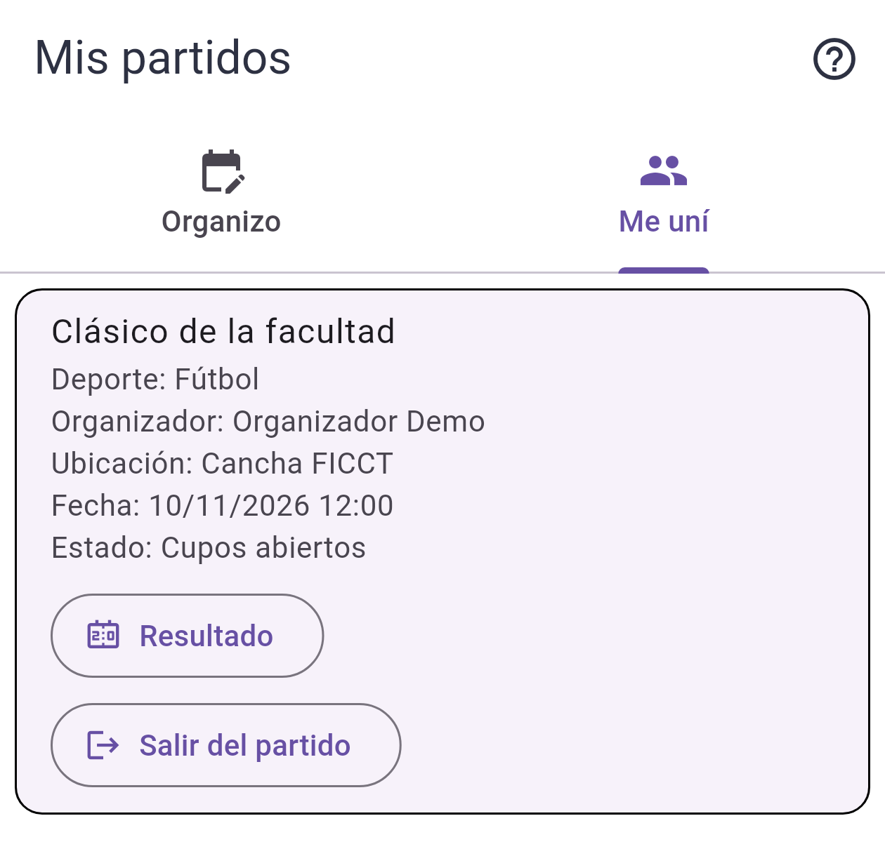
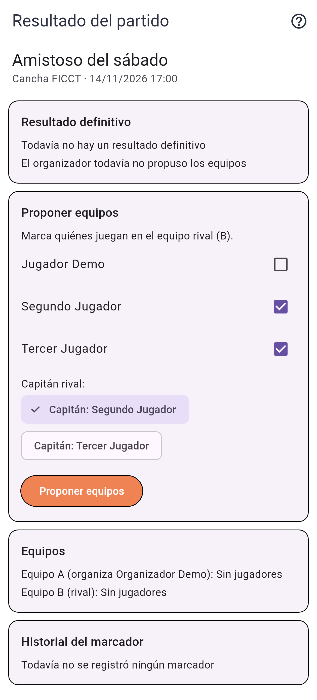
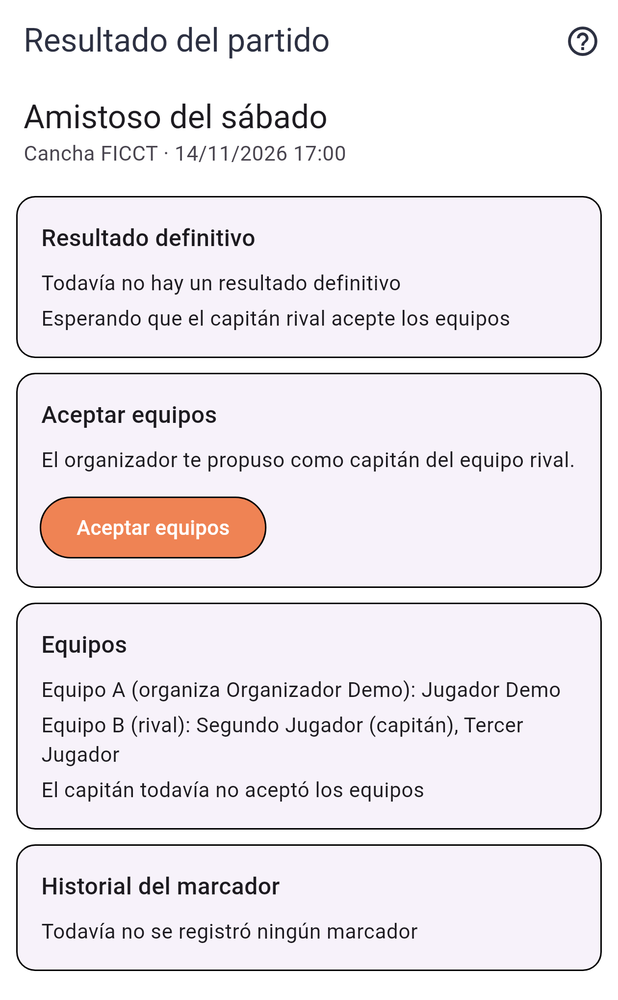
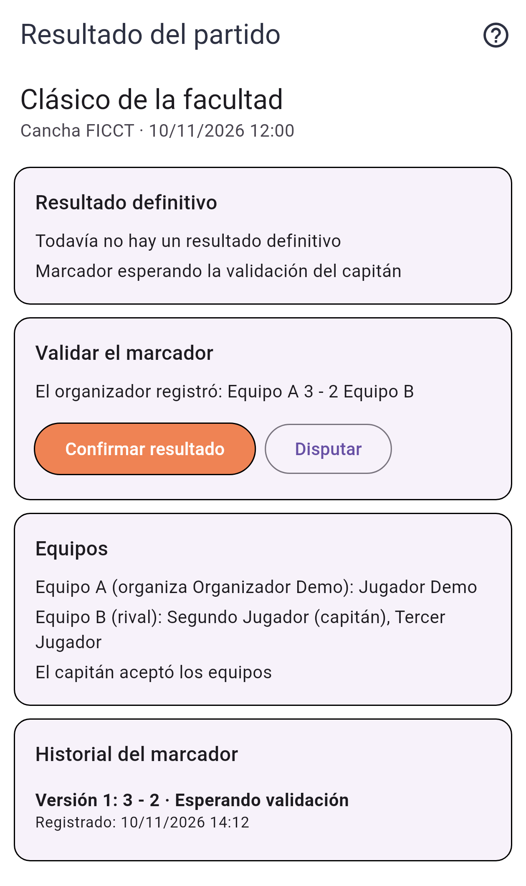
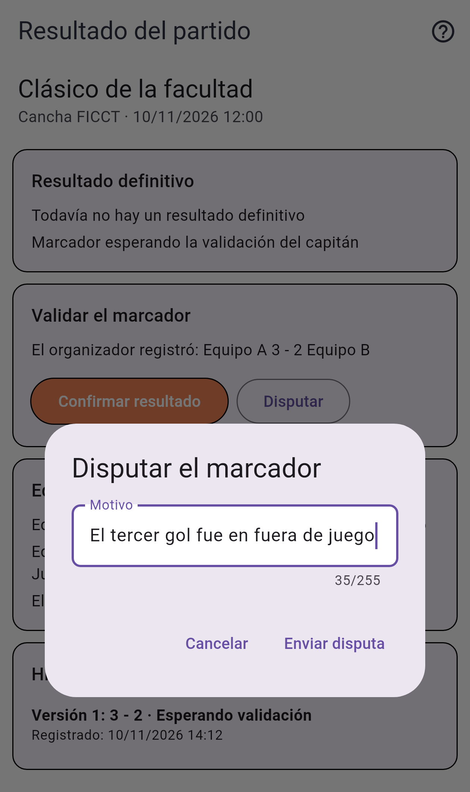
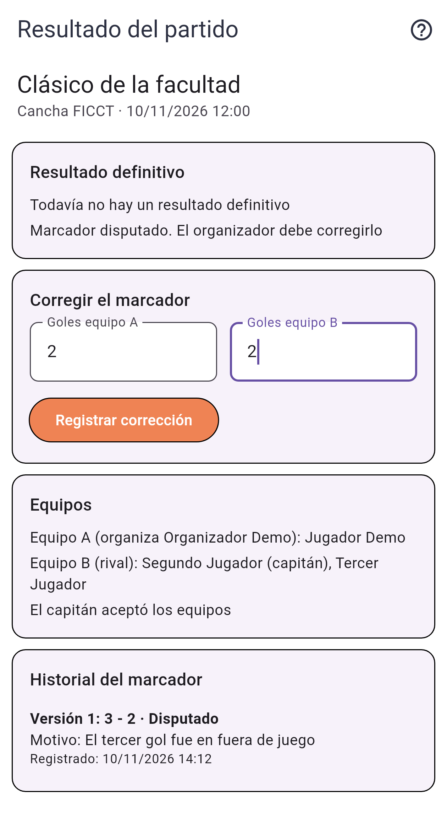
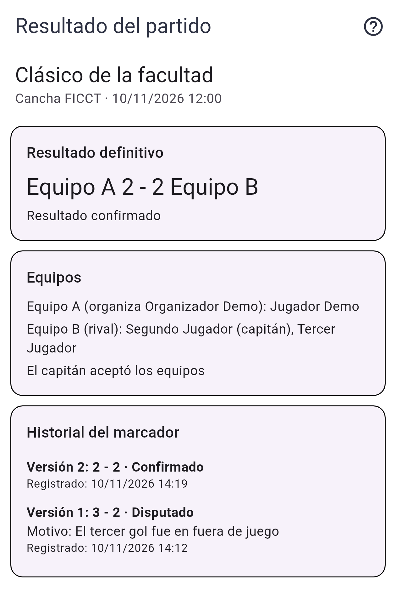

# Tarea 8 · Permisos y validación entre personas (UniSport)

## Integrantes

- Diego Andrés Astete Paz
- Lorgio Choque Severiche

**Proyecto:** UniSport, una aplicación para organizar partidos y completar equipos (Flutter + FastAPI + PostgreSQL).

## 1. Funcionalidad: validar el resultado

> **UniSport · Validar el resultado.** El organizador propone equipos y un capitán rival que acepta antes del partido. Al terminar, registra el marcador; el capitán confirma o disputa con motivo. Una corrección exige nueva validación.
> **Demuestren:** resultado → disputa → corrección → confirmación. Conserven el historial; solo el confirmado es definitivo.

### Actores y lo que puede hacer cada uno

| Actor | Puede hacer |
|---|---|
| **Organizador** | Proponer los equipos A y B y elegir al capitán rival dentro del equipo B. Registrar el marcador cuando termina el partido. Registrar una corrección después de una disputa. |
| **Capitán rival** | Aceptar los equipos antes del partido. Confirmar el marcador, o disputarlo escribiendo un motivo. |
| **Otros jugadores** | Ver los equipos, el estado, el resultado definitivo y el historial, sin acciones. |

### Estados

```text
sin_equipos ──(organizador propone)──► equipos_propuestos ──(capitán acepta, antes del partido)──► equipos_aceptados
                                              ▲   │
                       (organizador cambia los equipos: vuelve a pedir aceptación)

equipos_aceptados ──(termina el partido, organizador registra)──► resultado_pendiente
resultado_pendiente ──(capitán confirma)──► resultado_confirmado   ◄── DEFINITIVO, ya no cambia
resultado_pendiente ──(capitán disputa con motivo)──► resultado_disputado
resultado_disputado ──(organizador corrige: nueva versión)──► resultado_pendiente
```

Cada marcador es una **versión**. Una corrección crea una versión nueva y no borra la anterior: la disputada queda en el historial con su motivo. Solo una versión **confirmada** se muestra como "Resultado definitivo".

### Cómo se usa en la app

- El organizador entra a **Mis partidos → Organizo** y toca el ícono **Resultado del partido** (marcador) en la tarjeta.
- Los jugadores entran a **Mis partidos → Me uní** y tocan **Resultado**. "Me uní" ahora también muestra los partidos ya jugados, para que el capitán pueda validar el marcador después del partido (Explorar los oculta).
- La pantalla **Resultado del partido** muestra, en este orden: resultado definitivo y estado, la acción que le toca a quien la mira, los equipos y el historial del marcador. El botón de ayuda (?) explica los cinco pasos.

## 2. Decisiones

| Decisión | Motivo |
|---|---|
| Los permisos los decide la API, no la app. Si alguien que no es el capitán intenta confirmar o disputar, la API responde **403 `SOLO_CAPITAN`**; si alguien que no es el organizador intenta registrar el marcador, **403 `SOLO_ORGANIZADOR`**. | Ocultar un botón no alcanza: la regla tiene que valer aunque alguien llame a la API directamente. La app, además, solo muestra las acciones del rol de cada persona. |
| El capitán debe pertenecer al equipo B. | Es el capitán **rival**: valida el resultado quien no lo registró. |
| Los equipos se aceptan solo **antes** del partido y el marcador se registra solo **después**. | Así lo pide el enunciado ("acepta antes del partido", "al terminar, registra el marcador"). |
| Cambiar los equipos vuelve a pedir la aceptación del capitán, y no se pueden cambiar con un marcador registrado. | La aceptación vale para los equipos que el capitán vio. |
| Mientras un marcador espera validación no se puede registrar otro (**409 `RESULTADO_PENDIENTE`**). Con uno confirmado no se registra ninguno más (**409 `RESULTADO_CONFIRMADO`**). | Evita marcadores duplicados y que el definitivo cambie. |
| La disputa exige un motivo (**422 `MOTIVO_OBLIGATORIO`**). | El organizador necesita saber qué corregir. |
| El historial se guarda en una tabla propia (`partido_resultados`), una fila por versión. | Conservar todas las versiones sin pisar ninguna. |
| Datos de prueba: la semilla crea **"Clásico de la facultad"** (jugado hace 3 horas, equipos aceptados, capitán: Segundo Jugador) y **"Amistoso del sábado"** (la semana próxima, sin equipos). | La app no deja crear ni unirse a partidos con fecha pasada, y un E2E no puede esperar a que pase la hora real. La semilla deja los datos listos y siempre iguales (`seed.py --reset`). |
| En **Organizo**, la entrada es un ícono con tooltip junto a editar y eliminar; en **Me uní**, un botón con texto. | Un botón con texto en Organizo agrandaba la tarjeta y rompía un test de búsqueda existente (`list_partidoview_h7_test`). |

## 3. Archivos afectados

**Backend**

| Archivo | Cambio |
|---|---|
| [`backend/app/modules/partidos/resultado.py`](../backend/app/modules/partidos/resultado.py) | **Nuevo.** Reglas del proceso: proponer y aceptar equipos, registrar, confirmar y disputar el marcador, estado de la validación y lista de partidos donde participa el usuario. |
| [`backend/app/modules/partidos/router.py`](../backend/app/modules/partidos/router.py) | Endpoints nuevos y traducción de errores a 403, 409 y 422. |
| [`backend/app/modules/partidos/schemas.py`](../backend/app/modules/partidos/schemas.py) | Esquemas de equipos, marcador, disputa y respuesta de la validación. |
| [`backend/app/database/models.py`](../backend/app/database/models.py) | `Partido.capitan_rival_id`, `Partido.equipos_aceptados`, `PartidoParticipante.equipo` y la tabla `ResultadoPartido`. |
| [`backend/migrations/versions/c8a1d5e7f302_agrega_validacion_de_resultado.py`](../backend/migrations/versions/c8a1d5e7f302_agrega_validacion_de_resultado.py) | **Nueva** migración, reversible (se probó `upgrade`, `downgrade` y otra vez `upgrade`). |
| [`backend/seed.py`](../backend/seed.py) | Los dos partidos de prueba con sus jugadores. |
| [`backend/tests/test_partidos_resultado.py`](../backend/tests/test_partidos_resultado.py) | **Nuevo.** 16 pruebas del proceso, las restricciones y los códigos HTTP. |
| `backend/requirements.txt` | Se agrega `httpx`, que necesita el `TestClient` de FastAPI. |

**Endpoints nuevos** (todos bajo `/api/partidos`):

| Método y ruta | Quién | Qué hace |
|---|---|---|
| `GET /participando` | Jugador | Partidos en los que participa, incluidos los ya jugados. |
| `GET /{id}/validacion` | Organizador o jugador del partido | Equipos, capitán, estado, resultado definitivo e historial. |
| `PUT /{id}/equipos` | Organizador | Propone el equipo B y el capitán rival. |
| `POST /{id}/equipos/aceptar` | Capitán | Acepta los equipos. |
| `POST /{id}/resultados` | Organizador | Registra el marcador o la corrección. |
| `POST /{id}/resultados/confirmar` | Capitán | Confirma el marcador: pasa a ser definitivo. |
| `POST /{id}/resultados/disputar` | Capitán | Disputa el marcador con un motivo. |

**Frontend (Flutter)**

| Archivo | Cambio |
|---|---|
| [`frontend_flutter/lib/views/partido_view/resultado_partido_view.dart`](../frontend_flutter/lib/views/partido_view/resultado_partido_view.dart) | **Nueva** pantalla "Resultado del partido". |
| [`frontend_flutter/lib/models/validacion.dart`](../frontend_flutter/lib/models/validacion.dart) | **Nuevo** modelo de la validación y de cada versión del marcador. |
| [`frontend_flutter/lib/services/partido.dart`](../frontend_flutter/lib/services/partido.dart) | Llamadas a los endpoints nuevos. |
| [`frontend_flutter/lib/views/partido_view/list_partidoview.dart`](../frontend_flutter/lib/views/partido_view/list_partidoview.dart) | Ícono "Resultado del partido" en las tarjetas de Organizo. |
| [`frontend_flutter/lib/views/partido_view/partidos_unidos_view.dart`](../frontend_flutter/lib/views/partido_view/partidos_unidos_view.dart) | Botón "Resultado" y lista desde `/participando`. |
| [`frontend_flutter/test/resultado_partido_test.dart`](../frontend_flutter/test/resultado_partido_test.dart) | **Nuevo.** 5 widget tests de la pantalla por rol y estado. |
| [`frontend_flutter/integration_test/validar_resultado_test.dart`](../frontend_flutter/integration_test/validar_resultado_test.dart) | **Nuevo** E2E del recorrido completo. |
| [`frontend_flutter/integration_test/equipos_y_permisos_test.dart`](../frontend_flutter/integration_test/equipos_y_permisos_test.dart) | **Nuevo** E2E de permisos y estados pendientes. |
| [`frontend_flutter/integration_test/helpers_resultado.dart`](../frontend_flutter/integration_test/helpers_resultado.dart) | **Nuevo.** Pasos compartidos de los dos E2E. |
| [`run_suite.sh`](../run_suite.sh) | Acepta `SUITE_OUT_DIR` para guardar el resultado de la suite en otra carpeta. Sin la variable funciona igual que antes. |

## 4. Commits

| Commit | Contenido |
|---|---|
| [`c53f4d8`](https://github.com/Lorgio09/proyecto2_ihc/commit/c53f4d868ce453879cc3d24a7dc435a18d318396) | feat: validar el resultado del partido entre organizador y capitán rival (backend, migración, semilla y pruebas) |
| [`248b0b8`](https://github.com/Lorgio09/proyecto2_ihc/commit/248b0b8f5c59990bcc45628827e9055afa26f2d5) | feat: pantalla Resultado del partido para validar el marcador |
| [`3618164`](https://github.com/Lorgio09/proyecto2_ihc/commit/361816471716f2cea20bf746db88e26dd98aee62) | test: E2E de la validación del resultado y de los permisos de equipos |

El commit de esta evidencia agrega este archivo, las capturas, el resultado de la suite y el cambio de `run_suite.sh`.

## 5. Capturas

Pantallas en tamaño de teléfono, con los mismos nombres de la semilla.

| 0. Entrada desde "Me uní" | 1. El organizador propone equipos y capitán |
|---|---|
|  |  |

| 2. El capitán acepta los equipos | 3. El capitán valida el marcador 3-2 |
|---|---|
|  |  |

| 4. El capitán disputa con motivo | 5. El organizador corrige a 2-2 |
|---|---|
|  |  |

| 6. Resultado confirmado e historial |
|---|
|  |

### Datos guardados en PostgreSQL después de los E2E

```
         nombre         | version | goles_a | goles_b |   estado   |           motivo_disputa
------------------------+---------+---------+---------+------------+-------------------------------------
 Clásico de la facultad |       1 |       3 |       2 | disputado  | El tercer gol fue en fuera de juego
 Clásico de la facultad |       2 |       2 |       2 | confirmado |

         nombre         |  capitan_rival  | equipos_aceptados
------------------------+-----------------+-------------------
 Amistoso del sábado    | Segundo Jugador | t
 Clásico de la facultad | Segundo Jugador | t

       nombre        |     jugador     | equipo
---------------------+-----------------+--------
 Amistoso del sábado | Jugador Demo    | A
 Amistoso del sábado | Segundo Jugador | B
 Amistoso del sábado | Tercer Jugador  | B
```

## 6. Pruebas E2E

### E2E 1 · Recorrido completo: [`validar_resultado_test.dart`](../frontend_flutter/integration_test/validar_resultado_test.dart)

Sobre "Clásico de la facultad", con tres cuentas distintas, contra el backend real:

1. **Organizador** registra 3-2 → "Marcador esperando la validación del capitán", sin resultado definitivo y sin botón de confirmar para él.
2. **Capitán** (Segundo Jugador) lo disputa con el motivo "El tercer gol fue en fuera de juego" → "Disputado" con el motivo en el historial.
3. **Organizador** registra la corrección 2-2 → versión 2, otra vez esperando validación y todavía sin definitivo.
4. **Capitán** confirma → "Equipo A 2 - 2 Equipo B".
5. **Persistencia al recargar:** se reinicia la app y entra **otro jugador** (Jugador Demo, equipo A). Ve el 2-2 definitivo, la versión 2 confirmada, la versión 1 disputada con su motivo y ninguna acción.

### E2E 2 · Restricción de permisos y estados pendientes: [`equipos_y_permisos_test.dart`](../frontend_flutter/integration_test/equipos_y_permisos_test.dart)

Sobre "Amistoso del sábado" (todavía no se jugó):

1. **Organizador** marca a Segundo y Tercer Jugador en el equipo B y elige como capitán a Segundo Jugador → "Esperando que el capitán rival acepte los equipos".
2. **Tercer Jugador**, que está en el equipo B pero no es capitán, ve la propuesta pero **no tiene el botón "Aceptar equipos"**.
3. **Capitán** acepta → "Equipos aceptados. El marcador se registra al terminar el partido".
4. **Persistencia al recargar:** se reinicia la app, y el organizador ve la aceptación guardada pero **no puede registrar el marcador** porque el partido todavía no terminó.

Las restricciones que la app no deja intentar desde la interfaz (otro usuario que llama a la API, duplicados, motivo vacío) están cubiertas en `test_partidos_resultado.py`, incluida una prueba HTTP que comprueba los **403**.

## 7. Cómo ejecutar las pruebas

Desde la raíz del repositorio:

```bash
# Todo: backend, widget tests y los 8 E2E. Guarda el resultado en evidencias/tarea-8/
SUITE_OUT_DIR=evidencias/tarea-8 ./run_suite.sh despues linux

# Solo los E2E (levanta PostgreSQL, aplica migraciones, recarga la semilla y arranca la API)
./run_e2e.sh linux

# Por partes
cd backend && source .venv/bin/activate && python -m pytest -q
cd frontend_flutter && flutter test
```

`run_e2e.sh` ejecuta `seed.py --reset` antes de los E2E, así cada corrida empieza con los mismos datos.

## 8. Resultado de la suite

Corrida completa del 10/11/2026 sobre el commit `3618164` (archivos: [`suite-despues-backend.txt`](tarea-8/suite-despues-backend.txt), [`suite-despues-flutter.txt`](tarea-8/suite-despues-flutter.txt)):

| Suite | Resultado |
|---|---|
| Backend (pytest) | **57 pasan** (41 anteriores + 16 nuevas) |
| Widget tests (flutter test) | **44 pasan, 1 falla** en esta corrida; **45/45** después de corregir la captura base (ver abajo) |
| E2E `crear_partido_test` | 2 pasan |
| E2E `cuenta_test` | 6 pasan |
| E2E `equipos_y_permisos_test` (**nuevo**) | 1 pasa |
| E2E `explorar_unirse_salir_test` | 2 pasan |
| E2E `login_test` | 2 pasan |
| E2E `mis_partidos_test` | 4 pasan |
| E2E `suplentes_test` | 1 pasa |
| E2E `validar_resultado_test` (**nuevo**) | 1 pasa |

Los 6 E2E anteriores siguen pasando: la funcionalidad nueva no introdujo regresiones.

### Fallo pendiente explicado (ya corregido)

- **`test/visual_test.dart: Mis partidos se ve igual que la captura base`.** Este test compara la pantalla con una captura guardada. **Ya fallaba en `main` antes de esta tarea** (commit `0321778`): la Tarea 7 agregó el botón "Reprogramar" a las tarjetas y la captura base no se actualizó. Se comprobó corriendo el test sobre una copia limpia de `origin/main`.
- **Corrección** ([`071be9a`](https://github.com/Lorgio09/proyecto2_ihc/commit/071be9aa8f1a51fc43555b4df3569c7953a65f70)): se revisó que la pantalla actual es la correcta (tiene "Reprogramar" de la Tarea 7 y el ícono "Resultado del partido" de esta tarea) y se regeneró solo esa captura con `flutter test --update-goldens test/visual_test.dart --plain-name "Mis partidos se ve igual que la captura base"`. Después, `flutter test` da **45/45**. No quedan fallos pendientes.
