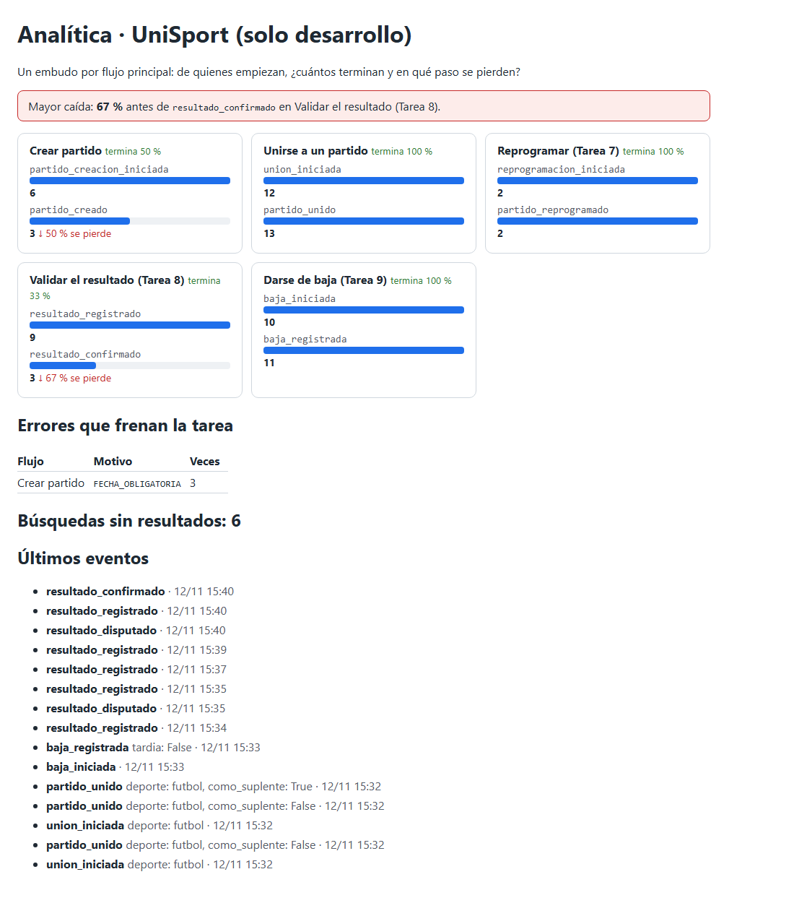

# Tarea 9 · Analítica en todo el producto y darse de baja con plazo (UniSport)

## Integrantes

- Diego Andrés Astete Paz
- Lorgio Choque Severiche

**Proyecto:** UniSport, una aplicación para organizar partidos y completar equipos (Flutter + FastAPI + PostgreSQL).

| Parte | Commit |
|---|---|
| A · Analítica en todo el producto | `feat: medir todos los flujos principales con embudos, errores y búsquedas vacías` |
| B · Darse de baja con plazo | [`3ce87b5`](https://github.com/Lorgio09/proyecto2_ihc/commit/3ce87b50dd9b8a38e3f8a55dc473cc1e5ce46d70) |

---

## Parte A · Que toda la app nos diga dónde se traba la gente

**Pregunta general:** en cada flujo principal, ¿cuántos de los que empiezan terminan y en qué paso se pierden?

### Dónde va cada evento (app map)

```text
Inicio ─► Mis partidos ─► (+) Formulario ─► Guardar            crear_partido:  ○ partido_creacion_iniciada → ○ partido_creado
Inicio ─► Explorar ─► Buscar ─► Unirse                         unirse:         ○ union_iniciada → ○ partido_unido
Mis partidos ─► Reprogramar ─► Diálogo ─► Reprogramar          reprogramar:    ○ reprogramacion_iniciada → ○ partido_reprogramado
Resultado del partido ─► Registrar ─► Confirmar / Disputar     validar:        ○ resultado_registrado → (resultado_disputado) → ○ resultado_confirmado
Me uní / Explorar ─► Salir del partido ─► Confirmar            darse de baja:  ○ baja_iniciada → ○ baja_registrada {tardia}
Cualquier paso que se frena                                    ● tarea_fallida {flujo, motivo}
Explorar con filtros y sin resultados                          ● busqueda_sin_resultados {filtros}
```

○ evento de inicio o de éxito · ● evento de error o de búsqueda vacía.

Los eventos de **inicio** los manda la app al empezar. Los de **éxito** los registra el backend solo después de guardar, así no se pueden falsear desde la app.

### Plan de eventos

| Evento | Flujo | Archivo:línea | Pregunta que responde |
|---|---|---|---|
| `partido_creacion_iniciada` | Crear partido | `frontend_flutter/lib/views/partido_view/list_partidoview.dart:199` | ¿Cuántos abren el formulario de nuevo partido? |
| `partido_creado` | Crear partido | `backend/app/modules/partidos/router.py:90` | ¿Cuántos de ellos terminan de crearlo? |
| `union_iniciada` | Unirse | `frontend_flutter/lib/views/partido_view/explorar_partidos_view.dart:173` | ¿Cuántos tocan Unirse? |
| `partido_unido` | Unirse | `backend/app/modules/partidos/router.py:270` | ¿Cuántos quedan inscritos y cuántos como suplente? |
| `reprogramacion_iniciada` | Reprogramar (Tarea 7) | `frontend_flutter/lib/views/partido_view/list_partidoview.dart:292` | ¿Cuántos organizadores empiezan a reprogramar? |
| `partido_reprogramado` | Reprogramar (Tarea 7) | `backend/app/modules/partidos/router.py:324` | ¿Cuántos lo terminan? |
| `resultado_registrado` | Validar resultado (Tarea 8) | `backend/app/modules/partidos/router.py:448` | ¿Cuántos marcadores se registran? |
| `resultado_disputado` | Validar resultado (Tarea 8) | `backend/app/modules/partidos/router.py:481` | ¿Cuántos marcadores disputa el capitán? |
| `resultado_confirmado` | Validar resultado (Tarea 8) | `backend/app/modules/partidos/router.py:464` | ¿Cuántos llegan a ser definitivos? |
| `baja_iniciada` | Darse de baja (Tarea 9) | `frontend_flutter/lib/views/partido_view/partidos_unidos_view.dart:69` y `explorar_partidos_view.dart:209` | ¿Cuántos tocan "Salir del partido"? |
| `baja_registrada` | Darse de baja (Tarea 9) | `backend/app/modules/partidos/router.py:302` | ¿Cuántos salen de verdad y cuántos tarde? |
| `tarea_fallida` | Todos | Backend: `router.py:84, 282, 305, 327, 386, 415, 430, 446, 462, 479`. App: `list_partidoview.dart:204, 288, 299` | ¿Qué validación o permiso frena cada flujo y cuántas veces? |
| `busqueda_sin_resultados` | Buscar en Explorar | `backend/app/modules/partidos/router.py:139` | ¿Qué filtros dejan a la gente sin partidos? |

`track()` y la lista fija de motivos están en `backend/app/modules/analitica/service.py`. Los motivos son los códigos de error de la API (por ejemplo `FECHA_NO_FUTURA`, `YA_INSCRITO`, `SOLO_CAPITAN`) más las validaciones que hace la app antes de enviar (`FECHA_OBLIGATORIA`, `CAMPOS_INCOMPLETOS`, `SIN_CAMBIOS`). Cualquier otro valor se guarda como `OTRO`.

### Qué datos decidimos no recopilar y por qué

| No se guarda | Por qué |
|---|---|
| Id, nombre o email del usuario | Las preguntas se responden contando acciones, no personas. |
| Lo que el usuario escribe al buscar | Basta saber **qué filtros** usó; el texto puede contener datos personales. |
| El motivo que escribe el organizador al reprogramar y el de una disputa | Es texto libre; para el embudo alcanza saber que ocurrió. |
| El marcador | Ninguna pregunta lo necesita. |
| Cada clic o cada pantalla abierta | No responden ninguna pregunta; solo intentos (inicio) y logros (éxito). |

El backend descarta cualquier propiedad que no esté en la lista permitida (`deporte`, `como_suplente`, `tardia`, `flujo`, `motivo`, `filtros`) y la app no puede registrar eventos de éxito (responde 422).

### Panel con embudos

`http://127.0.0.1:8000/analitica` muestra un embudo por flujo, con la cantidad de cada paso, el % que se pierde entre pasos y el % que termina. Además, la **mayor caída**, los errores por flujo y motivo, y las búsquedas sin resultados. Los mismos eventos se envían a Google Analytics 4 (Informes → Tiempo real).



### Paso con la mayor caída y qué cambiaríamos

Los números del panel salen de usar la app con las cuentas de prueba durante las E2E; no son de usuarios reales.

| Flujo | Inicio | Éxito | Se pierde |
|---|---|---|---|
| **Validar el resultado (Tarea 8)** | 9 `resultado_registrado` | 3 `resultado_confirmado` | **67 %** ← mayor caída |
| Crear partido | 6 `partido_creacion_iniciada` | 3 `partido_creado` | 50 % |
| Unirse, reprogramar y darse de baja | | | 0 % |

**Mayor caída: entre registrar el marcador y confirmarlo.** Dos causas, que el panel permite ver:

1. Cada disputa obliga al organizador a registrar otra versión, así que un mismo partido suma varios `resultado_registrado` antes de un `resultado_confirmado`.
2. El capitán no se entera de que tiene un marcador por validar: tiene que entrar por su cuenta a Mis partidos → Me uní → Resultado.

**Qué cambiaríamos:**

- Mostrar en la tarjeta de **Me uní** una marca "Resultado por validar" cuando el capitán tiene un marcador pendiente (visibilidad del estado, H1).
- En la disputa, ofrecer motivos frecuentes para elegir ("gol anulado", "marcador mal escrito") además del texto libre, para que el organizador corrija bien al primer intento.

**Segunda caída: crear partido (50 %).** Los 3 abandonos tienen el mismo motivo en `tarea_fallida`: `FECHA_OBLIGATORIA`. La gente intenta guardar sin elegir fecha. Cambiaríamos el formulario para que la fecha venga **ya marcada en mañana** (la primera fecha válida), o para que el campo de fecha se vea como obligatorio desde el principio.

### Hallazgo de las pruebas: Explorar se desbordaba con filtros activos

La E2E de la búsqueda sin resultados encontró un error real: con cualquier filtro activo, el panel de filtros de Explorar crece (muestra las etiquetas de filtros activos) y, como estaba fijo arriba de la lista, **se desbordaba 41 px** en un teléfono de 1080×2340 y el contenido quedaba cortado. Se arregló en la interfaz: el panel ahora se desplaza junto con la lista (`explorar_partidos_view.dart`).

---

## Parte B · Darse de baja con plazo

> **UniSport · Darse de baja con plazo.** Un jugador sale hasta 2 horas antes y sube el primer suplente. Después del plazo, la salida queda como «baja tardía», visible para el organizador. El organizador no puede darse de baja.
> **Prueba:** una baja a tiempo con ascenso del suplente y una baja tardía registrada.

### Reglas implementadas

| Regla | Dónde |
|---|---|
| Salir con más de 2 horas de anticipación funciona como siempre y sube el primer suplente. | `service.py`: `PLAZO_BAJA`, `es_baja_tardia`, `salir_partido` |
| Salir dentro de las 2 horas se permite (el lugar se libera y sube el suplente), pero queda en el historial como `baja_tardia`. | `salir_partido` |
| El organizador ve "Bajas tardías: …" en la tarjeta del partido (Mis partidos → Organizo). | `datos_partido` → `bajas_tardias`; `list_partidoview.dart` |
| Antes de salir dentro del plazo, la app avisa que quedará como baja tardía y que el organizador lo verá. | `explorar_partidos_view.dart`, `partidos_unidos_view.dart` |
| El jugador ve "Te diste de baja tarde" en su historial. | `historial_partido.dart` |
| El organizador no puede darse de baja (`ORGANIZADOR_NO_PUEDE_SALIR`). | ya existía; se probó |

### Decisiones

| Decisión | Motivo |
|---|---|
| La baja tardía **se permite** y queda registrada, en lugar de bloquearse. | El enunciado dice que "la salida queda como baja tardía": si se bloqueara, el jugador igual no iría y el organizador no se enteraría. |
| El suplente también sube en una baja tardía. | El lugar queda libre igual; es justo cuando más se necesita un reemplazo. |
| La baja tardía se guarda en `historial_participaciones` (acción `baja_tardia`), sin tabla nueva. | El historial ya es el registro de lo que hizo cada jugador; las bajas a tiempo siguen sin registrarse, como decidió la Tarea 6. |
| Siguen valiendo las restricciones de la Tarea 8: no se puede salir de un partido ya jugado, ni siendo capitán rival, ni con los equipos aceptados. | No romper la validación del resultado. |

### Datos de prueba

`seed.py --reset` crea dos partidos más:

- **"Baja con tiempo"**: en 2 días, 1 cupo. Jugador Demo es titular y Segundo Jugador espera como suplente.
- **"Baja de último momento"**: empieza 90 minutos después de cargar la semilla. Tercer Jugador es titular.

### Pruebas

- **Backend** (`backend/tests/test_partidos_baja.py`, 4 pruebas): baja a tiempo con ascenso, baja tardía con ascenso y registro, el límite de 2 horas y el organizador que no puede salir.
- **E2E** (`frontend_flutter/integration_test/baja_con_plazo_test.dart`):
  1. Jugador Demo sale de "Baja con tiempo" y ve la confirmación normal.
  2. Tercer Jugador sale de "Baja de último momento" y la app le avisa que quedará como baja tardía.
  3. El organizador ve en "Baja con tiempo" a Segundo Jugador como titular (1/1) y ninguna baja tardía.
  4. El organizador ve "Bajas tardías: Tercer Jugador" en el otro partido.
  5. Se registraron 2 `baja_iniciada` y 2 `baja_registrada`.

---

## Resultado de las pruebas

Corrida completa del 12/11/2026, contra el backend real y PostgreSQL, en el emulador Android (Pixel 5, API 36).

| Suite | Resultado |
|---|---|
| Backend (pytest) | **74 pasan** (66 anteriores + 4 de la baja con plazo + 4 nuevas de analítica) |
| Widget tests (flutter test) | **47 pasan** |
| E2E `baja_con_plazo_test` (**nuevo**, Parte B) | 1 pasa |
| E2E `crear_partido_test` (+ eventos) | 2 pasan |
| E2E `equipos_y_permisos_test` | 1 pasa |
| E2E `explorar_unirse_salir_test` (+ eventos y búsqueda sin resultados) | 3 pasan |
| E2E `login_test` | 2 pasan |
| E2E `mis_partidos_test` | 4 pasan |
| E2E `reprogramar_test` (**nuevo**, eventos de la Tarea 7) | 1 pasa |
| E2E `suplentes_test` | 1 pasa |
| E2E `validar_resultado_test` (+ eventos) | 1 pasa |
| E2E `cuenta_test` | 5 pasan, 1 falla (ver abajo) |

Cada E2E de un flujo lee `/api/analitica/resumen` antes y después y comprueba cuántos eventos de inicio, éxito o fallo se registraron (`integration_test/helpers_analitica.dart`).

**Fallo previo, no relacionado:** `cuenta_test: Usuario cambia su contraseña con sesión iniciada` falla en este emulador al tocar "Ingresar" por segunda vez. Se comprobó que falla igual con el código de `origin/main` sin ningún cambio de esta tarea, así que no es una regresión.

**Ajustes en E2E existentes por los cambios de interfaz:**

- `explorar_unirse_salir_test` y `suplentes_test`: como el panel de filtros ahora se desplaza con la lista, sus campos de texto también son zonas desplazables; las pruebas toman la de la lista (`.first`), igual que ya hacía `helpers_resultado.dart`.
- `explorar_unirse_salir_test`: con los dos partidos nuevos de la semilla, el botón Unirse podía quedar justo debajo del borde; ahora la prueba lo hace visible antes de tocarlo, como haría una persona.

`validar_resultado_test` y `baja_con_plazo_test` fallaron una vez cada uno al ser la primera prueba de una corrida (la lista de "Me uní" tardó más en cargar) y pasaron al repetirlos.
